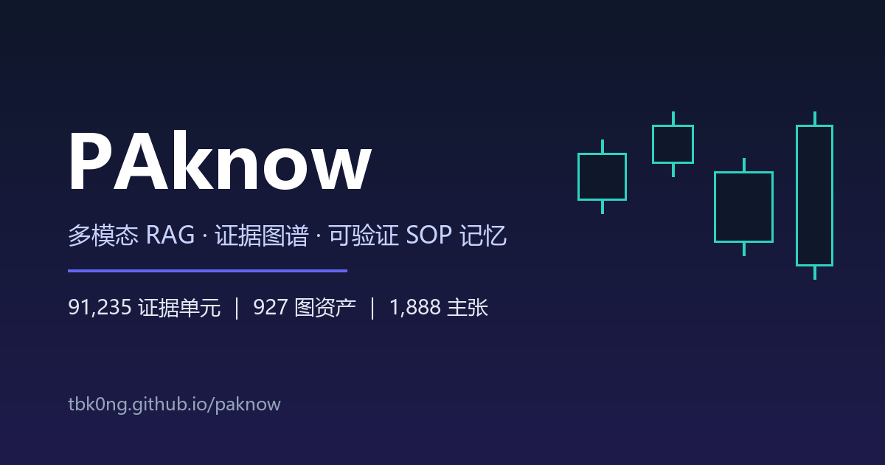

# PAknow



多模态检索、证据图谱与可验证 SOP 记忆系统。对本地 PDF/EPUB 价格行为资料做
**可追溯出处**的知识问答、上传图表分析，并保留程序性记忆（SOP）的生命周期。

> 技术文档站：<https://tbk0ng.github.io/paknow/>（源码 `book/`，MkDocs Material）。
> 回测/行情统计按实施决策暂缓；质量评测已起步，回归门槛只覆盖确定性记录（见下文“评测”）。

## 能力

- **知识问答**：中英术语双语检索（BGE-M3 dense + 自研 TF 稀疏 + RRF 融合），
  答案逐项绑定证据编号，程序渲染为可点击出处（`《书名》→ 章节 → 图号 → 页`）。
- **上传图表分析**：结构化读图（`ChartRead`）先把图上事实读成字段，再检索条件/反例；
  读图结果不是证据，不能产生 `[n]`。
- **证据图谱**：178 概念 / 927 图节点、1,888 主张（带 `context`/`modality`）、3,753 边
  （`SUPPORTED_BY`、`ILLUSTRATED_BY`、`INVALIDATED_BY`、`TRANSITIONS_TO`、`PART_OF`、`EXCEPTION_TO`），
  有界 BFS 扩展，结果不可引用。
- **SOP 记忆**：`candidate → replay_validated → shadow → active → superseded/retired`
  生命周期 + git 版本；当前两个 SOP 分别停在 `candidate` / `shadow`。
- **来源定位**：PDF 保留物理页 / 章内印刷页 / 章节 / 图号分别存储；EPUB 保留
  spine 阅读顺序 + 锚点 + 图注邻接。

## 架构

```
本地 PDF/EPUB → 解析(EPUB 原生 / PDF PyMuPDF) → 证据单元+图资产(内容寻址)
   → 索引(BGE-M3 dense / 自研 TF 稀疏 / 目录 / Qwen 视觉观察) → 多路召回+RRF融合
   → 证据充分性检查(有界补检索) → deepseek-flash 生成(逐项引用) → RunTrace
```

关键组件：

| 层 | 模块 |
|---|---|
| 契约 | `paknow/evidence|graph|memory/contracts.py`（Pydantic） |
| 持久化 | `paknow/db/models.py`（SQLAlchemy，默认 SQLite） |
| 摄入 | `paknow/ingest/{manifest,epub,pdf,chunk,ocr,persist,pipeline}.py` |
| 检索 | `paknow/retrieval/{embedding,tokenize,qdrant_store,index,search,pipeline,toc,barref,dictionary,visual}.py` |
| 图谱 | `paknow/graph/{contracts,identity,taxonomy,extract,align,expansion}.py` |
| 读图 | `paknow/chart.py`（`ChartRead` / `read_chart` / `chart_queries`） |
| 工作流 | `paknow/workflows/{router,evidence,generate,graph,sop_exec}.py`（LangGraph） |
| 记忆 | `paknow/memory/{trace,sop,optimizer,versions,gitstore}.py` |
| 服务 | `apps/api/main.py`（FastAPI）+ `apps/viewer/index.html` |
| 集成 | `integrations/paknow-mcp/`（MCP 适配器，11 个工具，走 HTTP） |

## 规模与实测（本地库快照 2026-10-24）

| 指标 | 值 |
|---|---|
| 资料 | 7 份 = 4 PDF + 3 EPUB |
| 证据单元 | 91,235（paragraph 61,040 / heading 19,194 / footer 9,426 / caption 1,575） |
| 图资产 | 927（全部有 VLM 观察，标记 `derived_observation`） |
| 主张 / 边 | 1,888 / 3,753 |
| BarRef | 674 |
| 索引点 | 81,809（Qdrant 嵌入式；超官方 20,000 点建议值约 4 倍，未做基准） |

评测（数据集入库，产物在 `.scratch/`）：

- 3 个冻结集：20 题（v1）、60 题 / 4 层（v2）、10 张图（chart），均带 SHA-256。
- 检索：同宽度下图谱扩展把期望证据命中从 41/123 提到 55/123（+14）；60/60 题触到
  ≤14 条证据截断；并集探针 73/123，说明链路损耗 18 条。
- 答案：60 题 × 2 臂，硬约束 60/60 通过；覆盖率 0.2333 vs 0.2500；盲评正确性 1.183 vs 1.250（满分 2），
  无支撑主张 146 vs 119；配对 10 好 / 6 差 / 44 平。
- 图表：10 题全量，价位漏读 1.8%（3/164）、多读 8.0%、漂移 0；金标准是一次模型初读，
  **尚未人工确认**，所以三个率只能当回归基线。
- **分层短板**：20 道机制题覆盖率 ≈0，沿边扩展补不了论证链。

口径与复现方法见 [`book/chapter14-evaluation.md`](book/chapter14-evaluation.md)。

## 未闭环 / 未接线

- **评测门槛只覆盖确定性部分**：`tests/test_eval_artifacts.py` 守住数据集↔旁车↔运行记录↔
  [评测](book/chapter14-evaluation.md) 的数字；检索与生成要有索引和 API key 才跑得起来，
  所以质量变差仍不会阻塞合入。
- **SOP 8 个操作名里 5 个空转**：只有 `expand_terms` 与 `check_evidence` 生效；
  `step_back` / `multi_query` / `hyde` / `expand_figures` / `rerank` 只写状态，`hybrid_search`
  是空操作，`stop` 无人消费。
- **SOP 对照回放**：`record_replay` 有接口、无数据，`active` 晋升因此关闭。
- **条件化主张半接线**：库里 `context`/`modality` 有值，消费端读 `conditions`/`exceptions`（0 条），条件只透传不筛选。
- **元数据过滤**：`QueryPlan.metadata` 已生成，检索层没有消费。
- **空路由**：`visual_page` / `numeric` 出现在 QueryPlan 里，主链路没有实现。
- **视觉集合**：`page_visual` 集合 0 点；只有“文本描述找图”，没有图像相似检索。
- **上下文压缩**：没有 LLMChainExtractor/Filter；靠 14 条证据截断 + 邻接控制窗口。
- **索引调优**：没有 HNSW 参数、量化、召回/延迟基准。
- **效果短板**：机制题覆盖率 ≈0；图表金标准尚未人工确认。
- **两张表未接线**：`user_facts`、`import_jobs` 有 schema，主链路未使用。
- **体验**：无流式、无查询缓存、无鉴权/多租户。

## 与 All-in-RAG 的对照

逐环节、逐方法（含代码位置与未接线清单）见
[`book/chapter12-allinrag-comparison.md`](book/chapter12-allinrag-comparison.md)。一句话结论：

> 教程给的是“通用文本 RAG 的标准件”；PAknow 在**证据定位、多模态派生、条件化图谱、
> SOP 记忆**上做了加法，在**评测、索引调优、上下文压缩、元数据过滤、Agentic 工具生态**上
> 留有欠账。加法多数是语料逼出来的；欠账多数有环境或成本理由，但不因此不算欠账。

## 快速开始

```bash
# 1. 依赖（Windows 上 torch/torchvision 必须用 CUDA index，PyPI 默认是 CPU 版）
uv venv .venv
uv pip install --python .venv --index-url https://download.pytorch.org/whl/cu128 "torch==2.9.1" "torchvision==0.24.1"
uv pip install --python .venv -e ".[dev]"
.venv/Scripts/pre-commit.exe install          # 提交前跑 pytest + scratch 校验

# 2. 配置：复制 .env.example 并填 DEEPSEEK_API_KEY
cp .env.example .env   # 默认 SQLite + 嵌入式 Qdrant；服务端模式的 URL 示例在文件里注释着

# 3. 全量摄入 + 索引（首次会下载 BGE-M3 ~2.2GB）
.venv/Scripts/python.exe scripts/ingest_all.py

# 4. 视觉观察索引（Qwen2.5-VL，首次下载 ~8GB）
.venv/Scripts/python.exe scripts/index_visual.py

# 5. 图谱与结构化指代（完整顺序见 book/chapter10-examples.md）
.venv/Scripts/python.exe scripts/build_taxonomy.py --apply
.venv/Scripts/python.exe scripts/align_claims.py --apply

# 6. 启动服务
.venv/Scripts/python.exe -m uvicorn apps.api.main:app --port 8000
# 打开 http://localhost:8000 提问
```

## 默认存储（离线零依赖）

- 权威元数据：SQLite（`data/paknow.db`），`PAKNOW_DB_URL` 可切 Postgres（未实测）。
- 向量：Qdrant **嵌入式本地模式**（`data/objects/qdrant`），同一时刻只允许一个进程持有
  （`data/objects/qdrant.lock`，第二个进程直接 503，不会返回空结果）；`QDRANT_URL` 可切
  server 并绕过该锁（`docker-compose.yml` 给了 postgres 16 + qdrant 1.12.4）。
- 启动自检：API 起来之前只读地确认 `evidence_text` 集合存在且可计数；未建库 / 集合为空 /
  被占用三种情况各有自己的报错并**拒绝启动**，不会出现"进程活着但答案永远为空"。
- 派生对象（图片/中间件）：`data/objects/` 内容寻址。
- 云端：`deepseek-flash`（`ModelGateway` 可换）；图片输入需 `DEEPSEEK_VISION=true`，
  默认 `false` 时上传图片会被直接拒绝。

## 接口（`apps/api/main.py`，12 个路由）

- `POST /query` — 问答（路由→检索→核验→生成→记录）；带 `history` 时先做独立问句改写
- `POST /search` — 只检索不生成（供 Agent 补证/核对）
- `POST /charts` — 上传截图分析，额外返回 `chart_read` / `chart_read_status`
- `GET /evidence/{id}` / `GET /sources/{doc_id}` — 证据/来源定位
- `GET /sources/{doc_id}/page/{page}/image` — PDF 页渲染（查看器用）
- `GET /figures/{figure_id}/image` — 图资产原图
- `GET /documents` — 资料库文档目录
- `GET /runs/{run_id}` — 审计 trace；`GET /sops` — SOP 版本
- `GET /health` — 存活探针（进程只在存储就绪后才起得来，所以"活着"即可用）；`GET /` — 单页查看器

`/query` 的响应是扁平结构：`answer`（字符串）、`uncertainty`、`citations`、`figures`、
`rounds`、`graph_stats`、`graph`、`run_id`、`intent`、`is_framework`、`routes`，
多轮时再加 `query_used` / `rewritten`。它不返回 `hits` / `barrefs`（那两个在 `/search`
与内部 `run_query` 里）。

## MCP 集成

`integrations/paknow-mcp/` 是一个不导入 PAknow 内部模块的 MCP 适配器，通过 HTTP 调用
上述接口，暴露 `paknow_ask`、`paknow_chart`、`paknow_search`、`paknow_evidence`、
`paknow_documents`、`paknow_source`、`paknow_page_image`、`paknow_figure_image`、
`paknow_run`、`paknow_sops`、`paknow_health`，并附带 `skills/paknow/SKILL.md`。

```bash
cd integrations/paknow-mcp
uv pip install -e .
paknow-mcp                       # stdio
paknow-mcp --transport streamable-http --port 8765
```

发布包包含 wheel、sdist、skill、`MANIFEST.json` 与 `SHA256SUMS`；构建与解包验证脚本见
`integrations/paknow-mcp/scripts/`。

## 验证

```bash
.venv/Scripts/python.exe scripts/smoke_full.py    # 摄入+索引+检索
.venv/Scripts/python.exe scripts/smoke_query.py   # 端到端问答(含引用)
.venv/Scripts/python.exe scripts/smoke_chart.py   # 图表上传链路
.venv/Scripts/python.exe scripts/smoke_ingest.py  # EPUB 解析
.venv/Scripts/python.exe scripts/smoke_pdf.py     # PDF 第93页/图4.5/印刷页7
```

冒烟脚本只打印链路结果、不做断言；要判好坏跑评测：

```bash
.venv/Scripts/python.exe scripts/eval_gold.py       # 召回（3 种口径，可 --text-width）
.venv/Scripts/python.exe scripts/eval_answers.py    # 答案双臂（可断点续跑）
.venv/Scripts/python.exe scripts/eval_judge.py      # 盲评
.venv/Scripts/python.exe scripts/eval_chart.py      # 图表价位
```

## 技术文档站

```bash
.venv/Scripts/python.exe -m mkdocs serve --dev-addr 127.0.0.1:8080  # 本地预览（避开 API 的 8000）
.venv/Scripts/python.exe -m mkdocs build --strict                   # 坏链接/坏 nav 直接报错
.venv/Scripts/python.exe -m mkdocs gh-deploy --force                # 手动发布
```

正式发布走 CI：`.github/workflows/docs.yml` 在 `main` 上改动 `book/**` 或 `mkdocs.yml`
时自动 `gh-deploy --force --clean --strict`。

## 已核验的端到端结果（示例）

问题「双底多头旗形的两个低点必须一样吗？」→ 答案引用原文
"about the same / around the same price / bottoms do not have to be exactly
at the same price"，并区分 micro double bottom bear flag 反例，`uncertainty`
明确价差阈值未说明。

## 未完成 / 待补

- 真实行情数据 + 回测（暂缓）。
- 生产链回归门槛、SOP 对照回放、机制题检索——三件按顺序解锁。
- 视觉观察覆盖 927 张图资产（观察式索引，非图像相似检索）。

## 视觉方案说明（Blackwell 适配）

ColPali（PaliGemma）在本机 **RTX 5060 Ti（Blackwell sm_120）+ torch 2.9.1** 上触发
CUDA 内核越界崩溃；ColQwen2 checkpoint 又依赖 colpali_engine（要求 transformers 4.x）。
故视觉路由改用 **Qwen2.5-VL-3B**（Blackwell 兼容、transformers 5.x 原生）：对图资产生成
结构化观察，观察文本作为**派生索引材料**（非权威来源）进入同一 dense + TF 稀疏索引。
上传图表分析走 cloud vision（`deepseek-flash`，需 `DEEPSEEK_VISION=true`）。
