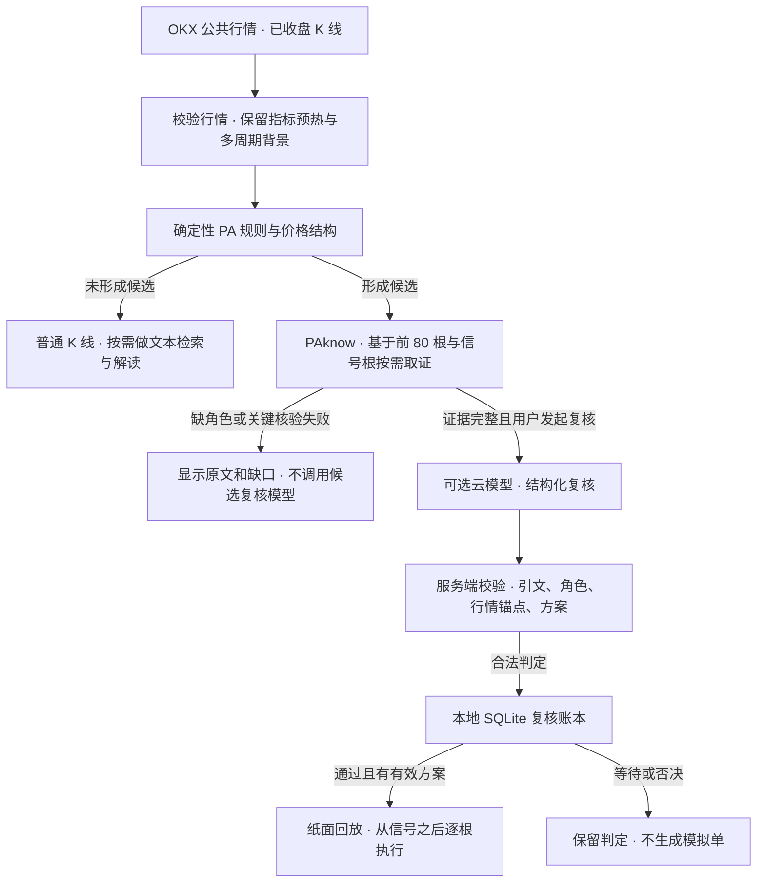
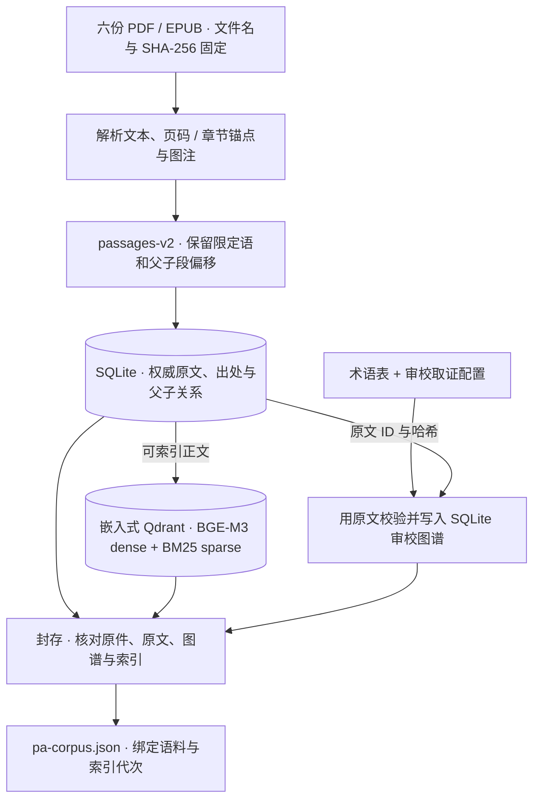
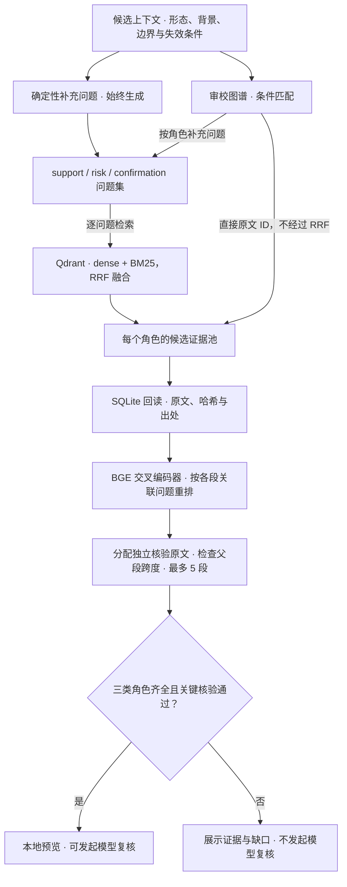

# PA Agent · PAknow

**用确定性规则提名价格行为候选，用原文证据约束模型复核，再用已收盘行情做逐根纸面回放。**

PA Agent 是一个本地价格行为（Price Action，PA）研究工作台。PAknow 是内置的 RAG 取证模块：它不仅查找相似段落，还要求候选复核的**支持、反证、确认**分别落到可回读、可逐字核验的独立原文。模型可以否决、等待或给出同向的条件式方案，但不能创建候选，也不能下单。

[架构总览](#架构总览) · [PAknow RAG](#paknow-rag从建库到取证) · [快速启动](#快速启动) · [验证与文档](#验证与文档)

## 架构总览



- **行情与规则**：默认展示 OKX `BTC-USDT-SWAP` 最近 480 根已收盘的 15 分钟 K 线。额外历史用于预热和背景；下载失败只回退到已校验的真实快照，并标明非最新，不用合成行情补缺。规则检查同向收盘、15 分钟趋势、1 小时反向风险、EMA20 附近回踩、二次测试或 EMA 代理，并检查参考价位是否构成有效结构。`15m / 1h / 4h` 逐根决策卡描述背景与下一根收盘情景，4 小时背景不单独产生或否决候选。
- **复核与回放**：信号后的行情只进入回放，不进入该信号的复核。已保存的判定可查看原文、行情锚点和方案；已经发起但失败的模型调用另存为尝试，不会生成模拟单。版本与输入不相容时，旧结论仍留在历史账本，不直接当作当前结果。回放按候选独立模拟，同根无法分辨止盈止损先后时按保守规则处理；收益展示未扣手续费、滑点和资金费。
- **工作台**：FastAPI 提供同源 API 与单页界面，无需前端构建。打开、刷新、切换与播放不会自动复核。可先本地预览证据，再显式调用模型；也可确认批量复核，冻结当前窗口。停止派发不会强行中断已发出的请求。

## PAknow RAG：从建库到取证

### 1. 离线：原文库、检索索引与审校图谱



- [原件清单](configs/pa_corpus_sources.yaml)记录六份文件的名称和 SHA-256。导入只处理文本，保留作者图注和定位，不存储图片，也不对扫描页执行 OCR。长段落的父段用于展开阅读，子段保留原文与相对偏移，避免引文脱离限定条件。
- **SQLite 是证据源，Qdrant 是派生索引。** 向量命中供系统定位候选段，不直接作为引用。小型审校图谱同样存放于 SQLite：用 [规范术语](configs/terms.yaml) 和 [审校配置](configs/pa_graph_sources.yaml)连接「概念 → 条件主张 → 原文」。它不是全量知识图谱，也不会从章节标题自动推导关系。
- 封存时核对 SQLite 与 Qdrant 的证据一致性，生成 `pa-corpus.json`。启动时校验封存、SQLite 摘要与 BM25 代次；数据库和对象目录不能来自不同构建。

### 2. 在线：图谱出线索，文本检索找段落，原文核验定角色



1. **规划**：`support` 查形态成立的依据，`risk` 查反证、障碍与失效条件，`confirmation` 查下一步需要观察什么。系统始终生成确定性补充问题；命中审校图谱时，再加入图谱问题和它直接指向的原文 ID。图谱只影响查什么，不改变候选规则。
2. **检索与重排**：每个问题分别做 BGE-M3 语义向量与 BM25 关键词召回，Qdrant 用 RRF（倒数排名融合）合并两路结果；直接图谱线索不参加 RRF，和文本召回结果在汇合、回读原文后一起重排。普通 K 线走独立的文本检索路径，可扩展相邻段落，不要求三角色证据包。
3. **核验与选证**：只接受可引用的原文或 OCR 文本。图谱线索的审校哈希必须与 SQLite 保存的哈希和回读原文重新计算的 SHA-256 同时匹配，才能标为对应角色的 `verified` 证据。优先填齐三类独立原文，同父段子块或重复正文不能重复占位；入选的核验子段还要检查父段跨度。`verified` 说明原文与取证关系可核验，**不代表当前行情已满足书中的条件**。
4. **降级与门禁**：图谱无匹配或不可用时仍可检索文本，但相似段落不能补成已核验角色。角色缺口或必要父段核验失败会阻止云复核；辅助检索或重排失败只要不破坏三角色完整性和关键核验，就只提示降级。

单笔预览不调用云模型、不写账本。证据齐全时，服务返回绑定候选指纹和语料代次的短期凭据，供界面用同一份证据包发起复核。复核模型接收该信号时可见的行情与证据摘录；服务端校验引用是原文中的连续子串、角色正确、行情锚点来自这 81 根 K 线、价格结构和执行条件有效。方案价可与锚定的 OHLC 参考价不同，二者及偏移会分开记录。纸面执行器只读取通过校验的结构化方案，不执行模型生成的代码或指令。

## 快速启动

在仓库根目录使用 **Python 3.14**。以下为 PowerShell 示例：

```powershell
python -m venv .venv
.\.venv\Scripts\python.exe -m pip install -e .
Copy-Item .env.example .env   # 仅在没有 .env 时执行
```

1. **准备本地语料库。** 克隆仓库不会附带原件、语料索引、权重或行情快照。已有封存库时，成对放置 `data/paknow.db` 和 `data/objects/`（含 Qdrant 与封存清单）。首次运行请准备有权使用、与清单匹配的六份原件，按[独立建库与封存](docs/agents/retrieval-dev.md#纯文本版的独立建库与封存)在隔离路径导入、封存后再切换。嵌入式 Qdrant 同一时刻只能由一个进程访问；不要让服务和建库、评估工具共用同一对象目录。
2. **配置模型。** 本地取证需要 BGE-M3 和 BGE 重排模型，可在 [`.env.example`](.env.example) 中查看 `HF_HOME` 配置。云模型可选：不填云密钥仍可查看行情、预览证据和浏览历史；需要模型复核时，按[供应商配置](docs/pa-agent.md#选择云模型与思考档位)选择 Terra 或 DeepSeek。明确发起云调用会把复核输入发送至所选供应商，注意费用和数据使用范围；不要提交密钥。
3. **启动应用。**

   ```powershell
   .\.venv\Scripts\python.exe -m uvicorn apps.api.main:app --host 127.0.0.1 --port 8765
   ```

   打开 <http://127.0.0.1:8765/> 进入 `/pa-agent`，用 `GET /health` 检查服务。默认是本机研究环境，不面向公网或多用户部署。

主要接口：`POST /pa-agent/review-evidence` 仅本地取证，`POST /pa-agent/review` 发起单笔复核或读取已有结果，`GET /pa-agent/review-history` 查询已保存判定。界面用短期凭据复用预览；API 未传凭据时会按需取证，仍受同一证据门禁约束。

## 代码导航

| 模块 | 位置 |
| --- | --- |
| API 与单页工作台 | [`apps/api/`](apps/api/)、[`apps/viewer/pa_agent.html`](apps/viewer/pa_agent.html) |
| 行情、规则与逐根决策卡 | [`pa_market.py`](paknow/pa_market.py)、[`pa_rules.py`](paknow/pa_rules.py)、[`pa_decision.py`](paknow/pa_decision.py) |
| 原文导入与语料封存 | [`paknow/ingest/`](paknow/ingest/)、[`seal_pa_corpus.py`](scripts/seal_pa_corpus.py) |
| 混合检索、图谱规划与三角色证据包 | [`search.py`](paknow/retrieval/search.py)、[`pa_context.py`](paknow/graph/pa_context.py)、[`pa_packet.py`](paknow/retrieval/pa_packet.py) |
| 原文回读与引用 | [`citations.py`](paknow/evidence/citations.py) |
| 模型复核、账本、回放与批量 | [`pa_analysis.py`](paknow/pa_analysis.py)、[`pa_review.py`](paknow/pa_review.py)、[`pa_replay.py`](paknow/pa_replay.py)、[`pa_batch.py`](paknow/pa_batch.py) |

## 验证与文档

在安装了开发依赖（见 [`pyproject.toml`](pyproject.toml)）的项目环境中运行：

```powershell
python scripts/check_scratch.py
python -m pytest -q
```

测试覆盖语料封存、证据门禁、伪造引文、未来行情锚点、历史回放与批量失败处理，不需要访问真实行情或调用付费模型。离线 [`eval_pa_packet`](scripts/eval_pa_packet.py) 对照同一冻结候选的证据包在开启和关闭图谱时的原文跨度、角色缺口与取证耗时；[`bench_pa_retrieval`](scripts/bench_pa_retrieval.py) 用于测量本地取证耗时。图谱只覆盖已审校条件，检索覆盖、测试通过与回放收益都不能证明模型判断正确，也不构成交易绩效承诺。

- [PA Agent 使用手册](docs/pa-agent.md)：行情、单笔与批量复核、回放规则、模型配置与排错。
- [PAknow 取证详解](docs/pa-rag.md)：图谱条件、证据选取、语料代次和评估边界。
- [本地建库与检索维护](docs/agents/retrieval-dev.md)：独立构建、封存、切库回滚与离线验证。
- [术语表](GLOSSARY.md) · [上游规则版本和第三方许可](docs/licenses/pa-agent-notice.md)
