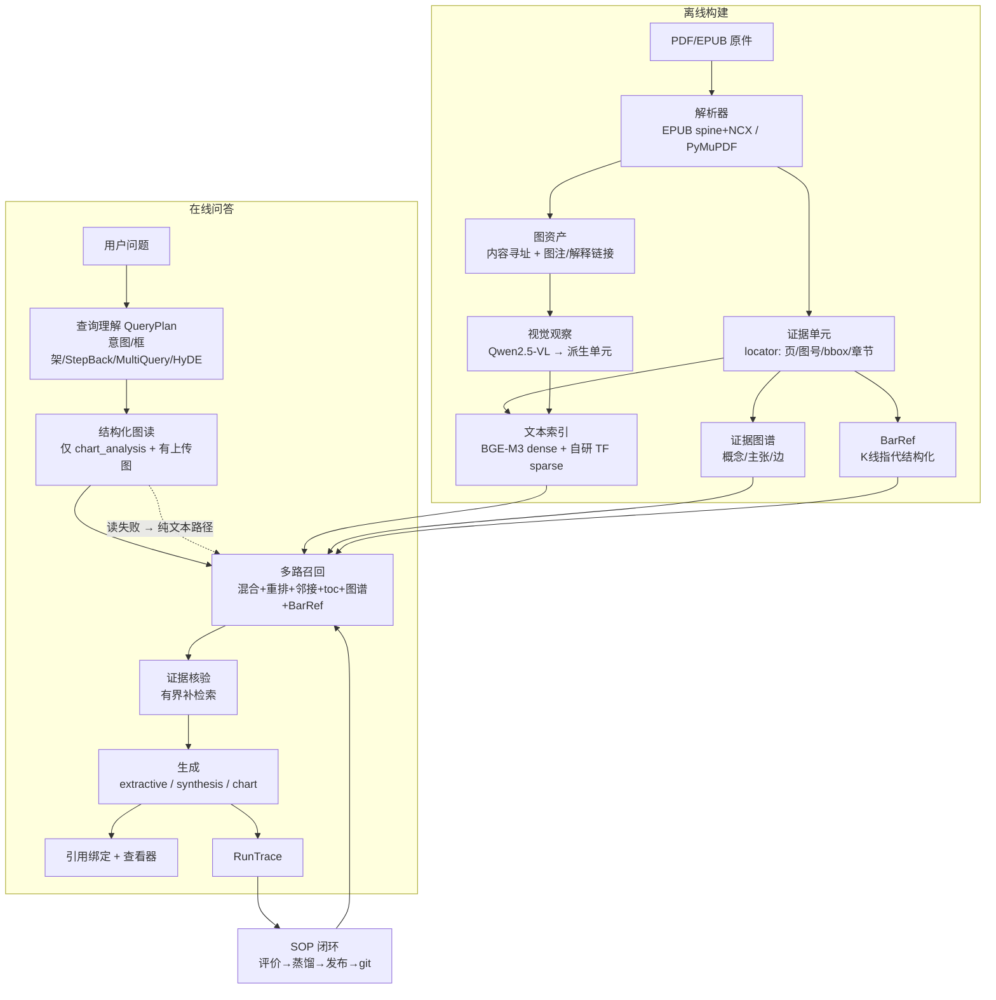

# 0. 系统架构与设计原则

> 本章先讲"这个系统为什么长这样"，后面每一章再展开一个环节。所有数字来自实际运行的数据库与索引，不是估算。

## 1. 目标与边界

系统服务三类任务，边界是刻意划清的：

| 任务 | 状态 | 说明 |
|---|---|---|
| 知识问答（定义/规则/机制/数值口径） | ✅ 已实现 | 检索 + 引用 + 归纳 |
| 上传图表分析 | ✅ 已实现 | 云端 vision + 截点遮罩 |
| 历史回测/行情统计 | ⏸ 暂缓 | 需要真实行情数据与明确规则；这是实施阶段确定的边界 |
| 人工金标准评测 | 🟡 已起步 | 评测集**已冻结**：3 套数据集（20 / 60 / 10 条，附 SHA-256）+ 4 个 harness（召回、回答、盲评、图表）；缺的是回归门禁，不是数据集 |

为什么先做前两类？因为它们**只依赖本地资料 + 云端模型**，能在离线环境（无 Docker、无外网行情源）跑通；回测依赖数据源与规则定义，草率接入只会产出不可信的数字。

## 2. 四条设计原则

### 2.1 证据优先，而不是"模型记忆优先"

每个回答都绑定 `[n]` 证据编号，编号最终映射到 `《书名》→ 章节 → 图号 → PDF 页/印刷页`。证据不足时宁可说"资料未说明"，也不让模型补全。

**为什么**：这批资料是交易方法书，读者最需要的是"作者原话在哪"，而不是"一个流畅的总结"。可追溯性也是后续人工评测的前提。

### 2.2 派生材料不冒充权威原文

系统里有三类"派生"内容：

| 派生材料 | 来源 | 处理方式 |
|---|---|---|
| 视觉观察文本 | Qwen2.5-VL 对图的描述 | `provenance=derived_observation`，生成时进"图读辅助"块，**不可引用** |
| 图谱主张 | LLM 从图注/标题抽取 | 带 `extraction_status`，检索时作为"上下文"而非证据 |
| SOP | 从失败记录蒸馏 | 有生命周期，`shadow` 状态参与但不作为唯一依据 |

**为什么**：RAG 系统最常见的隐性错误是"把模型生成的材料当成知识再检索回来"。一旦派生材料混入权威证据，引用体系就失去意义。

### 2.3 条件化知识必须保留条件

书中大量知识是条件式的："在强趋势中，回调是买入机会；在交易区间中，同样的回调常常是陷阱。" 系统用 `ClaimRow.qualifiers` 保留条件：**实际入库的键只有 `context` / `modality`**（1,888 条主张里这两个键各出现 1,888 次），条件随主张原样进入生成上下文。

需要说清口径：图谱扩展代码只读 `conditions` / `exceptions` 两个键（`paknow/graph/expansion.py:277-278`），而这两键当前在库里一条都没有——所以条件**不参与筛选或排序**，只是作为 `qualifiers` 字段整体带进上下文。主张真正被截断的顺序是 **种子概念顺序 → `extraction_confidence` 降序 → `claim_id`**（`paknow/graph/expansion.py:238-243`），没有"主题匹配 > 谓词匹配 > 条件匹配"这层逻辑。

**为什么**：去掉条件的知识图谱会产出危险的建议。系统因此把条件作为主张的一等字段。

### 2.4 记忆必须可验证、可回滚

SOP（程序性记忆）不是"模型说过的好答案"，而是**带状态、带版本、带回放记录**的制品。每次变更写 YAML 并 git commit；晋升到 `active` 需要对照回放。

**为什么**：没有验证的记忆会自我强化错误。系统明确禁止"模型自评当裁判"，自动闭环最多把候选推到 `shadow`。

## 3. 数据流总览

## 4. 技术栈选型总表

| 层 | 选择 | 关键理由 | 替代方案与不选原因 |
|---|---|---|---|
| 元数据存储 | SQLite（开发默认，`sqlite:///./data/paknow.db`） | 零依赖、离线可用；ORM 层用 SQLAlchemy | Postgres：需要服务/网络，当前不可行。`PAKNOW_DB_URL` 可指向 Postgres，但**切换未实测**——`scripts/backfill_figure_links.py:22` 直接调用 SQLite 的 `json_array_length`，所以"DB 无关"只在模型定义层成立 |
| 向量库 | Qdrant 嵌入式（本地模式） | 支持**命名向量**（dense+sparse 同点）、payload 过滤、`QDRANT_URL` 一改即切 server | FAISS：无 payload 过滤、混合检索要自己拼；Milvus：需要 Docker；`sqlite-vss`：生态弱。**代价**：客户端自己警告"Local mode is not recommended for collections with more than 20,000 points"（`data/link_log.txt:1`），而 `evidence_text` 实测 81,809 点，约为建议上限的 4 倍，且未做性能基准 |
| 嵌入 | BGE-M3（dense）+ 自研 TF 稀疏 | dense 1024 维、中英多语；稀疏侧自建（FNV 哈希 + jieba），见第 3 章 | 双模型（bge-large + BM25）：多一次加载与维护；E5：中文领域词表现不如 BGE-M3 |
| 重排 | bge-reranker-v2-m3 | 本地 GPU、跨语言、延迟可控 | LLM rerank：每问多一次云端调用，延迟/成本翻倍；ColBERT：需要 late-interaction 索引，Qdrant 嵌入式支持成本高 |
| 生成 | `deepseek-flash`（云端，`paknow/config.py:18` 默认值） | 中文强、成本低；`ModelGateway` 可替换；三种生成模式 `extractive` / `synthesis` / `chart`（`paknow/workflows/graph.py:194-201`）。图表问答的"结构化图读"也走这个网关，需要 `deepseek_vision=True`；默认 `False` 时 `_attach_images` 直接抛错（`paknow/gateway.py:213-219`），图读失败、退回纯文本路径 | 本地 LLM：16GB 显存下质量与速度都不可接受；微调：资料版权与数据量都不支持 |
| 编排 | LangGraph | 状态机 + 条件边，天然表达"检索→核验→补检索→生成" | 手写 while 循环：可读性差；LangChain Agent：对固定流程过重、不可控 |
| 视觉 | Qwen2.5-VL-3B（观察式） | Blackwell sm_120 + transformers 5.x 可用 | ColPali/ColQwen2：实测崩溃/依赖冲突（见第 2 章） |
| 记忆版本 | git（`sop_registry/`） | 每次变更可 diff、可回溯、可 blame | 数据库版本表：可回滚但不能 diff；对象存储：重 |

## 5. 明确"不选"的设计

- **不做多步 Agent 自主规划**：查询理解用**单次结构化调用**产出完整计划（意图、Step-Back、子查询、HyDE、证据需求、是否要举例）。多步 Agent 的灵活性换不来稳定性，且每多一步就多一次延迟与失败点。
- **不做"父块检索"**：原计划是子块命中 → 展开父块。实测发现父块单元在切分后被丢弃，`parent_id` 悬空（本地库快照 2026-10-24：1,670/1,670 不可解析），因此改为**阅读顺序邻接**回填（见第 1 章）。
- **不做 embedding 聚类去重**：近似重复抑制用"归一化前 80 字哈希 + 每书配额"即可覆盖主要重复（同一概念在多本书/多语言版本中出现），embedding 聚类的成本/收益不匹配。
- **不让模型自评记忆**：SOP 晋升需要对照回放；自动闭环只到 `shadow`。

## 6. 本章小结

- 系统是"**证据流水线 + 检索策略 + 程序性记忆**"三层结构，而不是"一个 RAG 接口"。
- 所有选型的共同标准是：**离线可用、可替换、可追溯**。
- 下一章从最源头开始：资料怎么审计、证据单元怎么设计。
