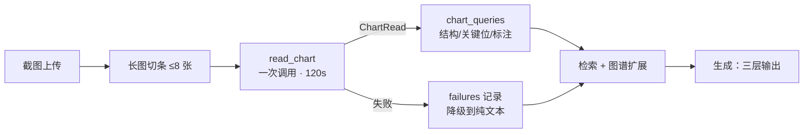

# 结构化读图：截图 → 字段 → 有边界的回答

> 这一页讲 `/charts` 背后真正发生的事。它不是"把图发给视觉模型"，而是先把图**读成一个
> 有类型的对象**，再用这个对象去检索、去组织答案。代码：`paknow/chart.py`、
> `paknow/workflows/graph.py`（`_read_node`）、`paknow/workflows/generate.py`（`_CHART_SYSTEM`）。

## 1. 截图问答的两个天然陷阱

直接"看图回答"会稳定地坏在两种地方：

1. **编价位。** 模型看不清某位数字，就按刻度或轴线"推算"一个。K 线图的价位差一位就是
   完全不同的交易结论。
2. **引用洗白。** 用户上传的截图里往往有上一轮的回答、带 `[1][2]` 标记；模型把这些标记
   当成资料引用抄进答案。于是"图上写的"变成了"书上说的"，引用链彻底失真。

这两个陷阱都不是提示词能靠"请注意不要编造"解决的：第一个需要**允许缺失的类型**，第二个
需要**在渲染层剥离引用标记**。所以读图不是一次对话，而是一次受约束的结构化抽取。



## 2. 读到什么：`ChartRead`

`ChartRead` 是读图与后续所有环节之间的唯一契约（`paknow/chart.py:39-55`）：

| 字段 | 类型 | 为什么这样设计 |
|---|---|---|
| `instrument` / `timeframe` | `str \| None` | 图上没印就写 `None`，并记进 `unreadable`；不按文件名或上下文猜 |
| `market_state` | `trend_up` / `trend_down` / `trading_range` / `unclear` | 只有 4 个值，检索侧能直接映射成措辞（见 §4） |
| `swings[]` | `kind`(high/low) + `price` + `strip` + `basis` | 每个摆动点必须带"图上依据"，便于人工复核 |
| `levels[]` | `price: float \| None` + `source`(annotation/swing/axis/unknown) + `strip` + `basis` | **任何一位看不清就是 `None`**，不推算；`levels` 全列不裁剪 |
| `focus[]` | `price` + `why`，5–8 条 | 从 `levels` 收敛出的建议关注位，固定优先级：图上标注 > 前高/前低 > ONH/ONL > 区间边缘/平台 > 均线 |
| `patterns` / `annotations` / `indicators` | `list[str]` | `annotations` 逐条抄图上原文（如 `2 @ 7519.75`），不改写不合并 |
| `unreadable` | `list[str]` | 不确定项单独成表；它是"我们不知道什么"的显式记录 |

`price: float | None` 是整页最重要的一个类型决定：**缺失是一等公民**。没有它，模型只有
"编一个"和"漏掉"两个选项；有了它，"看不清"可以如实传递到答案第一层，并且不参与任何
相似度计算（`scripts/eval_chart.py:110-113` 把 `None` 直接从可读位里排除，不算漏读）。

## 3. 一次调用，失败不重试

```python
out = client.chat_json(
    ChartRead, messages, images=list(images),
    max_tokens=8192, timeout=READ_TIMEOUT_S, attempts=1,
)
```

三处取舍：

- **`attempts=1`。** 读图预算 120 s，一次重试就会把整个请求推到不可接受的延迟；而且
  失败原因（超时 / 结构不合法 / 空返回）本身就是要记录的信号。
- **`max_tokens=8192`。** 推理 token 与输出共享预算，密集图在出 JSON 之前就烧掉约 5k；
  4096 稳定截断成非法 JSON。
- **失败不抛。** `read_chart` 返回 `(None, {"reason", "detail"})`，`_read_node` 把
  `chart_read: <reason>` 写进 `failures`，检索照常走纯文本路径（`paknow/workflows/graph.py:89-110`）。
  一张读不懂的图不该让整个问答挂掉。

失败分类只有三种：`timeout` / `invalid_structure` / `no_content`，前端与 trace 看到的是
同一个字符串。

### 长截图：条带

手机截图可能远超模型的单图分辨率。上传前按高度切成 **≤8 张全分辨率条带**，并做 JPEG
重编码以避开 provider 的 32 MB 单图上限（`paknow/gateway.py:21-55`）。条带数会写进读图
提示词的前两行，所以每条 `swing`/`level` 都带 `strip` 序号。

模型偶尔会写出越界条带号（如"条带 3/2"）。`_clamp_strips` 把它归到最近的合法条带，
价位不动，并在 `unreadable` 里追加一条"条带序号越界 N 处"——**纠正位置，不纠正读数**。

## 4. 读数如何进入检索

`chart_queries()` 从读数里生成最多 3 条子查询（`paknow/chart.py:170-194`）：

| 来源 | 查询句式 | 目的 |
|---|---|---|
| `market_state` + `patterns` | `"上升趋势 回调 买入 如何处理"` | 把"结构怎么用"落到资料 |
| `focus` 价位（拼接） | `"7519.75 7488 关键位 支撑 阻力"` | 让"这个位为什么重要"有原文支撑 |
| `annotations`（≤160 字符） | `"2 @ 7519.75 图上标注 含义"` | 图上手写标注的术语解释 |

它们被插在 `plan_queries[0]` 之后，与计划查询**共享 6 条上限**（`paknow/workflows/graph.py:112-135`）。
这意味着读图查询优先于多数量化改写，但不会挤掉用户原问题。

`levels` 为空时 `chart_queries` 直接返回空——非图表不产生任何检索扰动。

## 5. 生成：三层，引用只出现在第三层

`_CHART_SYSTEM`（`paknow/workflows/generate.py:37-50`）把答案钉死成三层：

| 层 | 内容 | 是否可引用 |
|---|---|---|
| 一、图上可读位 | 逐条全列，条数必须与读数完全一致；`None` 照写"看不清"；每条以 `图:` 开头 | 否 |
| 二、建议关注位 | 5–8 个，每个一句理由，体现固定优先级；冲突价位保留更极端的那个 | 否 |
| 三、资料依据 + 归纳 | 资料怎么定义/使用这些结构；归纳 ≤5 条 | 是，只有这里可以出现 `[n]` |

两个实现细节值得单独说：

- **第一层是预编号的。** `_render_chart_read` 把 `levels` 渲染成 `1. 7519.75 ｜ 来源 …`，
  答案只需复制这份清单，不必自己重新读图、重新排序。这消除了"同一张图，第一次答 8 个位、
  第二次答 6 个位"的不稳定。
- **读数里的 `[n]` 会被剥掉。** `_plain()` 用 `_CITATION = r"\s*\[\d+\]"` 清洗所有来自
  读数的文本——包括 `annotations` 和截图上本来就写着的 `[1]`。这样"截图里的上一轮答案"
  永远不能变成引用。

API 侧，`/charts` 与 `/query` 一样返回完整结构化载荷，并额外带 `chart_read` 与
`chart_read_status`（取值 `structured` / `unstructured` / `unclear`），查看器据此渲染
可折叠的"读图数据"面板（`apps/api/main.py:202-219`）。

## 6. 非图表：一条显式契约，而不是兜底

`is_non_chart()` 的判据只有一条：`market_state == "unclear"` **且** `levels`、`focus`、
`swings` 三者全空。只看 `unclear` 不够——一张只是难读的行情图仍然有结构；只有"什么结构
都没有"才是别的图（产品截图、纯文字页、照片）。

命中后 `_NON_CHART_SYSTEM` 接管：

- 第一句直接说"这不是行情图表"；
- 不列关键位、不展开教科书概念、不硬引证据；
- 只摘图上可见的文字与版式。

对应测试 `tests/test_chart_refusal.py` 与 `tests/test_chart_retrieval.py` 锁住了这条边界：
非图表问题不会退化成"看起来在分析行情"。

## 7. 读图结果**不是**证据

ADR-0002 的规则在这里落地得很具体：`chart_read` 不进入 `evidence_ids`，不能产生 `[n]`，
也不参与引用绑定。它只做两件事——给出图上的字面事实，和生成检索子查询。

这和视觉观察单元（`derived_observation`）是同一套哲学：**派生材料可以影响理解，不能
冒充出处**。区别在于观察单元还带着 `evidence_id`、可被检索命中，而读图结果连单元都不是。

## 8. 评测：先把"读得准不准"变成可判定的数

`evals/gold/chart_v1.json` 冻结了 10 张图（10 个数据页），判定完全确定性，不用 judge：

| 桶 | 定义 | 分母 |
|---|---|---|
| 命中 | 与期望价位精确相等（先做多重集匹配） | — |
| 漏读 miss | 期望价位没被读出来 | 期望价位总数 |
| 多读 extra | 读出的价位不在期望里 | 实际读出总数 |
| 漂移 drift | 同整数部分但不相等 | 命中 + 漂移（即实际呈现的价位） |

"漂移"单列是因为真实错误长这样：`7499.25` 读成 `7499.75`。它在"漏读"和"多读"里都
看不出来，但对交易结论是致命的。

全量 10 张图跑完（`.scratch/chart-analysis/eval/20261024T125057Z`）：

| 指标 | 值 |
|---|---|
| 期望价位 | 164 |
| 读出价位 | 175 |
| 命中 / 漏读 / 多读 / 漂移 | 161 / 3 / 14 / 0 |
| miss / extra / drift | 0.018 / 0.080 / 0.000 |

早先那次 `limit: 2` 的试跑（miss 0.875、读出 8 条）不能引用：它的 `dataset_sha256`
是 `18d205d3…`，与现在冻结的旁车 `d23799a4…` 不是同一份字节，两个数不可比。全量跑下来，
漏读只有 3 条（chart-06 的 `36.14`、chart-09 的 `184.0` 与 `171.0`）——**密集轴标签不是
主要矛盾**，多读的 14 条里 chart-02 独占 5 条，其余是相邻刻度与两个面板之间的价位。

数据集本身还有一个必须声明的口径：`expected_levels` 是**一次模型初读**的产物，`annotation`
字段写明 "the owner must confirm it against the pages"——**尚未人工确认**。它足以做回归，
不足以充当绝对金标准；0% 的漂移也因此不能当独立证据（金标准与答案同源）。

## 9. 已知边界

| 边界 | 现状 | 影响 |
|---|---|---|
| 读图精度 | 漏读 1.8%、多读 8.0%、漂移 0（10 题全量） | 第一层清单基本完整，多读仍需人工核对金标准 |
| 条带拼接 | 只按高度切，不处理重叠区域 | 跨条带的结构可能被读成两个 |
| 全量评测 | 10 题已跑完，但金标准未经人工确认 | 三个率可作回归，不可作绝对精度 |
| 失败重试 | 明确不重试 | 一次超时即降级为 `unstructured` |
| 数值分支 | `numeric` 路由仍未接线 | 读出的价位不会被拿去和行情数据比对 |
