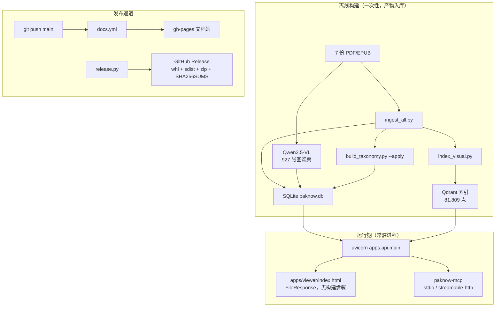

# 上线与交付

> 全书其它章节回答"系统怎么工作"，这一章只回答一个问题：**它凭什么能持续跑下去、跑坏了怎么退回来。**
> 口径先立：本项目是**自托管的单用户系统**（一台机器、一份索引、一个操作者），不冒充企业级多租户服务。
> 代码里没有的能力（鉴权、配额、灰度、指标端点）这里一律写"没有"，并写清缺了它意味着什么。

## 1. 九个维度先对一遍

| # | 维度 | 本项目的答案 | 结论 | 证据 |
|---|---|---|---|---|
| 1 | 构建与打包 | 依赖走 compose，参考数据走脚本重建，客户端走 wheel；**服务本身没有镜像** | 部分 | §3 |
| 2 | 发布 | 文档站全自动（`docs.yml`），MCP 适配器半自动（`release.py`），主服务手工 | 部分 | §4 |
| 3 | 更新方式 | 拉代码 + 重建索引 + 重启进程；没有 autoUpdater 之类的东西 | 手工 | §4 |
| 4 | 版本管理 | 版本号三处硬编码；真正的版本控制是**组件指纹**与 SOP 的 git | 部分 | §5 |
| 5 | 灰度 | 没有流量灰度；单写者锁使"两个版本同时跑"物理上不成立 | 无（有替代） | §6 |
| 6 | 回滚 | 数据层可回（`.bak` 备份、SOP git checkout、门禁基线拒用）；服务层无版本可退 | 部分 | §5、§9 |
| 7 | 日志与指标 | 无应用日志、无指标端点；**`run_traces` 表就是埋点表** | 部分 | §7 |
| 8 | 鉴权 | 服务端零鉴权、零配额；信任边界只有回环地址 + 索引独占锁 | 无 | §8 |
| 9 | 可观测性 | `run_id` 是唯一链路锚点，可回放整次请求；无 tracing、无 `exception_id`、无 `session_id` | 部分 | §9 |

**为什么不分维度"补齐"成企业级**：这套系统的用户就是作者本人。给单人系统加多租户、灰度平台与指标看板，写出来的是一堆没人读的代码，
换来的是一个"看起来很企业"的假象。真实工程判断是：**能说清每一项缺什么、缺了会怎样、什么时候必须补**，比补齐更值钱。

## 2. 交付链路总览



三条产物线互不共享发布节奏，这是理解整章的前提：

| 产物 | 内容 | 怎么再来一遍 | 不可复现的部分 |
|---|---|---|---|
| 依赖容器 | `postgres:16-alpine`、`qdrant/qdrant:v1.12.4`（`docker-compose.yml:2`） | `docker compose up -d` | — |
| 参考数据 | `paknow.db`（128 MiB）+ Qdrant 索引 | `ingest_all.py` → `index_visual.py` → `build_taxonomy.py --apply`，顺序有依赖 | 7 份里有 2 份不在脚本的 `SOURCES` 内（[第 1 章](chapter1-corpus.md) §1） |
| 客户端 | `paknow-mcp` 的 wheel/sdist + 技能包 | `release.py` | — |

## 3. 构建与打包

**服务端不做镜像，是明确的选择，不是漏做**。索引是嵌入式 Qdrant 的本地目录（`data/objects/qdrant`），
模型的加载依赖本机 GPU 与 CUDA 轮子；把它塞进容器只会把"模型跑不起来"从启动报错变成构建期报错。当前形态就是**裸进程 + 两个依赖容器**。

构建的三层：

1. **依赖**：`docker-compose.yml` 只起 Postgres 与 Qdrant，没有 app service。切到服务端模式只改 `PAKNOW_DB_URL` 与 `QDRANT_URL`，不改代码（见 [第 8 章](chapter8-service.md) §2）。
2. **参考数据**：三段脚本按序执行，任一段失败都不能继续——`index_visual.py` 读的是 `ingest_all.py` 写进库的证据单元，`build_taxonomy.py --apply` 又依赖图谱表。这也是为什么"重建索引"在本文档里等于"发一次数据版"。
3. **客户端**：`integrations/paknow-mcp/scripts/build_release.py` 产出确定性 bundle：`dist/*.whl|*.tar.gz` + `skill/paknow/SKILL.md` + `SHA256SUMS`（全文件 sha256）+ `MANIFEST.json`。
   `MANIFEST.json` 记录 `git_commit` 与 `git_dirty`（`integrations/paknow-mcp/scripts/build_release.py:130`）——**从脏工作区打出来的包，manifest 自己会承认**，`release.py` 随后会拒发。

前端没有构建产物：`apps/viewer/index.html` 是单文件，由 `FileResponse` 直接吐出来（`apps/api/main.py:378`）。
少一层 npm 构建，就少一类"线上跑的是旧前端"事故。

## 4. 发布与更新

| 通道 | 触发 | 自动化程度 | 失败时 |
|---|---|---|---|
| 文档站 | push 到 `main` 且命中 `book/**`、`hooks/**`、`mkdocs.yml` | 全自动：`mkdocs gh-deploy --force --clean --strict`（`.github/workflows/docs.yml:34`） | `--strict` 把坏链接当错误，构建失败即不发布，站点停在上一版 |
| 代码测试 | 任意 push / PR | 自动：`python scripts/check_scratch.py` 与 `python -m pytest -q`（`.github/workflows/check.yml:34`） | PR 红，但**不阻塞本地工作**（没有分支保护） |
| MCP 适配器 | 本地执行 `release.py --publish` | 半自动，五道门禁：测试通过 → 工作区干净 → bundle 验证通过 → `gh` 已登录 → tag 不存在 | 任一门禁失败即 `SystemExit`，不会产出半个 release |
| 主服务 | 人 | 手工：`git pull` → 重建索引 → 重启 `uvicorn` | **没有可回退的产物**，只能靠 git 回退源码 + 重建 |

发布动作的细节值得单独看，因为它是仓库里唯一一条完整的"门禁 → 打标 → 分发"链路：

```bash
# 只构建 + 验证，不发布
.venv/Scripts/python.exe integrations/paknow-mcp/scripts/release.py

# 构建 + 验证 + 打 tag + 发 GitHub Release
.venv/Scripts/python.exe integrations/paknow-mcp/scripts/release.py --publish
```

`--publish` 之前必须先跑过 `verify_release.py`：它把 bundle 解到临时目录，在**全新 venv** 里装 wheel，
再用 stdio 逐个探活 11 个工具，结果写 `VERIFICATION.json`。`release.py` 最后一步是
`gh release create <tag> … --verify-tag`（`integrations/paknow-mcp/scripts/release.py:174`），上传的正是那份带 `SHA256SUMS` 的产物。

**更新语义的三种**（面试里"用户怎么拿到新版本"问的就是这个）：

- 文档站：GitHub Pages 自动更新，读者刷新即最新；
- MCP 客户端：`pip install paknow-mcp==<version>`，或直接从 Release 下 zip；
- 主服务：**更新即重建**。语料或索引变了，`component_versions()` 的指纹随之变化，旧 SOP 自动失效（§5）——这既是更新机制，也是回滚的代价。

## 5. 版本管理

### 5.1 版本号：现状是散落的

| 位置 | 内容 |
|---|---|
| `pyproject.toml:3` | `version = "0.1.0"` |
| `apps/api/main.py:41` | `FastAPI(title="PAknow", version="0.1.0", …)` |
| `integrations/paknow-mcp/src/paknow_mcp/__init__.py:5` | `__version__ = "0.1.0"`（打包脚本唯一读取的源） |

三处各自独立，没有 CHANGELOG，也没有针对主应用的打标动作——仓库里唯一的 tag 由 `release.py` 生成，标的是 `paknow-mcp-v*`。
后果是可验证的：`/health` 只回 `{"status": "ok"}`
（`apps/api/main.py:221`），不带版本，于是 MCP 客户端 `paknow_health` 想读的 `server_version`
（`integrations/paknow-mcp/src/paknow_mcp/server.py:519`）**永远是 `None`**——"线上到底跑的是哪一版"这个问题，现在只能靠 `git log` 回答。

### 5.2 真正的版本工具是组件指纹

系统不靠版本号识别"我面对的是哪份数据"，靠指纹：`component_versions()`（`paknow/memory/versions.py:21`）把
语料散列（`sha1(证据单元数:最新 parsed_at)[:12]`）、图谱规模（`1105n/3753e`）、四个模型名打成一个 dict，
并**写进每一条 trace 的 `version_snapshot`**（`paknow/memory/trace.py:12`）。因此每一句答案都能回答"它是在哪份语料、哪套模型下产生的"。

实测（本地库 2026-10-26 快照，641 条 trace）：

| `version_snapshot.corpus` | 条数 | 含义 |
|---|---:|---|
| `2b9b41f6cc0c` | 444 | 当前指纹（父块回填后） |
| `a96ff4bfbbc2` | 182 | 回填前的语料 |
| 空 `{}` | 15 | 指纹查询失败时的历史行，如实留档 |

这就是"版本管理"在这套系统里唯一诚实的表述：**代码版本靠 git，数据版本靠指纹，两者都不靠语义化版本号。**

### 5.3 回滚的四条真实路径

| 对象 | 机制 | 代码位置 | 到哪一步 |
|---|---|---|---|
| 记忆（SOP） | YAML 入 git，每次变更自动 commit，可 checkout 任意版本 | `sop_registry/`、`paknow/memory/sop.py` | ✅ 完整 |
| 记忆（失效保护） | 指纹不符的 SOP **不被选中**，而不是被错误使用 | `paknow/memory/sop.py:152` | ✅ 完整（代价见 §9） |
| 数据库 | 破坏性迁移前先复制 `paknow.db.bak-<时间戳>`，默认 dry-run | `scripts/migrate_model_v2.py` | ✅ 单机可用 |
| 评估基线 | 数据集哈希不符即拒用旧基线；失败的运行永远不能写成基线 | `scripts/quality_gate.py` | ✅ 完整 |
| 服务二进制 | 无镜像、无归档包、无部署清单 | — | ❌ 不存在 |

最后一行是这张表最重要的部分：**能回滚数据，不能回滚服务。** 服务出问题的止损手段是 git 回退源码后重建并重启，
期间会话中已经入库的 trace 与 SOP 变更不会自动撤销（它们是数据，不是代码）。

## 6. 灰度：没有对象，所以没有机制

灰度发布要成立，前提是**能同时存在两个版本、并把一部分流量导给新的那个**。本项目两个前提都不成立：

- 嵌入式 Qdrant 一个索引目录只允许一个客户端，进程内用 `portalocker` 独占锁保证这件事（`paknow/retrieval/qdrant_store.py:97`）；
- 索引与数据库都在本机，第二个实例起来必然撞锁 → 启动自检直接拒启（`check_store_ready`，`paknow/retrieval/qdrant_store.py:148`）。

所以"灰度"在这里被替换成两个**本地等价物**，它们解决的是同一个问题（新东西只影响一小部分，出问题能识别出来）：

| 企业级灰度 | 本项目的替代 | 覆盖面 |
|---|---|---|
| 按比例放量 | SOP 生命周期：`candidate` → `shadow`（参与但不作唯一依据）→ `active` | 只覆盖记忆，不覆盖代码 |
| 灰度期观测 | 质量门禁的 10 题分层抽样（`scripts/quality_gate.py`），硬约束任一失败即退非零 | 只覆盖问答效果，不覆盖延迟与资源 |

两个替代都在"能识别一部分坏结果"上成立，但都不覆盖代码与索引的切换——因为代码切换在这个部署形态下就是一次重启，
没有中间态可言。

## 7. 日志与指标

### 7.1 日志：几乎没有

- 应用代码里**没有 logger**：`paknow/` 与 `apps/` 都没有 `import logging`，API 只有 uvicorn 默认输出；
- 仓库里唯一的 `logging.basicConfig` 在 MCP CLI，写 stderr、无文件、无轮转（`integrations/paknow-mcp/src/paknow_mcp/__main__.py:67` 的 `main`，`--log-level` 的 help 原文写着 "stderr only"）。

这不影响排障，因为排障不靠日志——靠下一节的 trace 表。日志缺席的代价是"排障必须能拿到 `run_id`"，而 `run_id` 只出现在响应体里。

### 7.2 `run_traces` 就是埋点表

每次 `/query` 落一行（`RunTraceRow`，`paknow/db/models.py:188`），字段即埋点：

| 埋点字段 | 记录什么 | 推导出的指标 |
|---|---|---|
| `output.degraded` | 这次回答是不是占位答案（`_resolve_answer` 明确"标记而不是按长度猜"，`apps/api/main.py:200`） | **答案可用率** |
| `failures` | `"stage: reason: detail"` 列表，结构化后分 `timeout` / `invalid_structure` / `no_content` / `error`（`apps/api/main.py:150`） | 各阶段失败率 |
| `elapsed_ms` | 整次请求耗时（`paknow/workflows/graph.py:311`） | P50 / P95 延迟 |
| `output.sufficiency` | 核验器判定 + 判定时看到的证据条数与字符数 | 证据充分率、上下文规模 |
| `routes` | 实际命中的召回路径，如 `["hybrid_text", "graph_local"]` | 路由分布（哪条召回在干活） |
| `request.sop` | 本次选中了哪个 SOP（无则缺键） | **记忆命中率** |
| `score_status` | `unscored` / `optimized` | 记忆被消费的比例 |
| `version_snapshot` | 语料指纹 + 图谱规模 + 模型名 | 指标的口径分层（按版本切） |
| `cost_usd` | 预留列（`paknow/db/models.py:201`） | **从未被赋值** —— 见下 |

指标定义与查询都是可执行的，不需要额外依赖：

```sql
-- 答案可用率 / 降级数
SELECT COUNT(*) AS runs,
       SUM(json_extract(output, '$.degraded') = 1) AS degraded
FROM run_traces;

-- 延迟（毫秒转秒）
SELECT COUNT(*) AS n, ROUND(AVG(elapsed_ms) / 1000.0, 1) AS avg_s,
       ROUND(MAX(elapsed_ms) / 1000.0, 1) AS max_s
FROM run_traces WHERE elapsed_ms IS NOT NULL;

-- 记忆命中率
SELECT json_extract(request, '$.sop') IS NOT NULL AS sop_selected, COUNT(*)
FROM run_traces GROUP BY 1;

-- 有失败的运行有多少
SELECT COUNT(*) FROM run_traces WHERE json_array_length(failures) > 0;

-- 成本列是不是死的
SELECT COUNT(*) AS runs, COUNT(cost_usd) AS with_cost FROM run_traces;
```

本地库 2026-10-26 快照（641 行，2026-10-18 → 10-26）的实际结果：

| 指标 | 值 |
|---|---|
| 运行数 / 其中降级 | 641 / 1（0.16%） |
| 延迟 平均 / P50 / P95 / 最大 | 40.6 s / 37.0 s / 69.1 s / 188.8 s |
| 带失败的运行 | 26（4.1%） |
| 选中 SOP 的运行 | 500（78%）；未选中 141 |
| `score_status` 分布 | `optimized` 635 / `unscored` 6 |
| `cost_usd` 非空 | **0 / 641** |

最后一行的意思是：**这张表的成本口径是空的。** 列在、契约里有 `cost_usd`（`paknow/memory/contracts.py:47`），
但 `save_trace` 从不传它，网关也不回传用量。所以"每次请求花多少钱"目前只能按 token 预算常量估算，不能测量。
这是本章第一条必须承认的欠账：**指标表有了，聚合层与成本口径没有。**

其余缺口同样明确：没有 `/metrics` 端点，没有 Prometheus / OpenTelemetry / Sentry 任何依赖，
`elapsed_ms` 只存不聚合（上面的 P50/P95 是一次性 SQL，不是看板）。

## 8. 鉴权：现在没有，且这是清醒的

**服务端零鉴权**。`app = FastAPI(...)`（`apps/api/main.py:41`）没有 `add_middleware`、没有 `Depends`、
没有 `HTTPBearer`，12 个路由全部匿名可访问；`/docs` 默认开着；没有 CORS、没有限流、没有每用户配额。
MCP 侧是**不对称**的：客户端在配置了 token 时会带 `Authorization: Bearer …`（`integrations/paknow-mcp/src/paknow_mcp/config.py:83`），
但服务端从不读取这个头——发出去没人校验。

那么现在的信任边界是什么？两条，都是结构性的：

1. **回环地址**：默认 `127.0.0.1:8000`，只有本机能连；
2. **单写者锁**：同一份索引只允许一个进程持有（§6），第二个进程拿到的是 `StoreLockedError` 而不是一份脏数据。

⚠️ 这条边界有一个具体的安全风险，必须写进文档：MCP 适配器支持
`--transport streamable-http`（`integrations/paknow-mcp/src/paknow_mcp/__main__.py:83`），该传输**没有任何鉴权**。
把它绑到非回环地址（`--host 0.0.0.0`），等于把全部 11 个工具——包括整库全文检索与页图渲染——暴露给能访问该端口的人。
在补上鉴权之前，**只允许回环地址**。

要开放给第二个人时，最小改造是三步，不是三步以外的任何东西：

1. 服务端读 `Authorization` 并与 `PAKNOW_TOKEN` 比对（一个依赖函数即可，覆盖全部路由）；
2. 反向代理做 TLS + 按 IP 限流；
3. 配额落到 `user_facts.user_id`（列已存在但从未被写入）与 `run_traces` 的按用户维度。

三步都未实现。触发条件是**用户数 > 1**，不是"像企业项目"。在此之前引入鉴权，收益为零、维护成本为正。

## 9. 可观测性：一次真实排查

`run_id` 是系统里唯一的链路锚点：`run_query` 入口生成（`paknow/workflows/graph.py:96`），随响应返回，
`GET /runs/{run_id}`（`apps/api/main.py:356`）可以取回意图、路由、证据 id、输出、失败、耗时。
没有 `request_id` 透传、没有 `session_id`、没有 `exception_id`、没有 span——所以"排查"只能是"拿着 `run_id` 反查"，不存在别的路径。

下面两个案例都是**本仓库当前状态下的真实问题**，不是编的演练。

### 9.1 案例 A：服务起不来 / 503

**现象**：`uvicorn` 启动失败，或运行中突然返回 `503 {"detail": …}`。

**定位**：启动自检 `check_store_ready`（`paknow/retrieval/qdrant_store.py:148`）给出三种机器可读原因之一：

| `reason` | 含义 | 处理 |
|---|---|---|
| `missing` | 集合不存在（没建库） | 跑入库脚本 |
| `empty` | 集合为空（入库未完成） | 等入库跑完再启 |
| `locked` | 索引被别的进程占用 | 读锁文件里的持有者 |

`locked` 是唯一需要"找进程"的情况，而锁文件已经写好了持有者身份：`pid` / `acquired_at` / `argv`
（写入点 `paknow/retrieval/qdrant_store.py:112`），报错原文会带上 `pid=…, since=…, cmd=…`。
常见持有者是评测或重建脚本——它们不释放锁是对的，因为释放等于让两个进程同时写同一份索引。

**为什么这样设计**：宁可拒启，也不做"活着但答案永远为空"的半死服务。这是把故障从"静默错误答案"前移到"进程起不来"。

### 9.2 案例 B：记忆静默失效

**现象**：图表分析的回答不体现 SOP 的步骤，但没有报错、没有降级标记、`/query` 一切正常。

**定位路径**（每一步都有具体字段）：

1. 取一次相关请求的 `run_id` → `GET /runs/{run_id}` → `request` 里**没有 `sop` 键**，说明这次没有选中任何 SOP；
2. 看 `GET /sops`：该 SOP 存在，状态也是可被选中的（`active` / `shadow` / `candidate`）；
3. 取它的 `compatible_versions`，与 trace 里的 `version_snapshot`（`paknow/memory/versions.py:21`）逐项比对——任一项不等就不再可选，最常见的是重建索引后 `corpus` 指纹变了；
4. **根因**：`select_sop`（`paknow/memory/sop.py:152`）对指纹不匹配的 SOP 直接 `continue`，不记日志、不写 trace、不报错。于是"记忆没生效"这个事实在任何可观测面上都不存在。

**处理方式二选一**：给该 SOP 升版本并刷新 `compatible_versions`（等于承认它是为旧语料写的，需要重新校验），
或者把跳过原因写进 trace 的 `failures`（让失效变成可查事件）。当前两者都没做——指纹保护是"静默正确"，代价是失效不可观测。

**一个反例说明保护范围**：`compatible_versions` 为空的 SOP 不受指纹约束，永远可选，也永远不会因为语料变化被拦下
（如 `sop_registry/knowledge_qa_term_evidence_first.yaml:43`）。指纹保护只对填了该字段的 SOP 生效。

**一个审计副产品**：`GET /query` 的 `debug: true` 只对单次请求暴露 `hits` / `failures`（`apps/api/main.py:176`），
**不产生跨请求的聚合**。上面两个案例能查清，靠的是"每次请求都落一行 trace"这个习惯，而不是任何日志系统。

## 10. 能对外声明的边界

口径统一到一个标准：**每个"部署/上线"字样，都要能在 30 秒内指到一条命令或一个字段。**

| 可以说（有代码/数据支撑） | 不能说 |
|---|---|
| 文档站持续部署，`main` 上改 `book/**` 自动发布，坏链接会导致构建失败 | "有完整的 CD 流水线"（只有文档有） |
| MCP 适配器的发布有五道门禁、产物带 `SHA256SUMS` 与 `git_commit` | "服务端有版本化发布与镜像回滚" |
| 每次请求的意图、路由、证据、失败、耗时、数据版本都落库，可按 `run_id` 回放 | "有全链路 tracing / 有 `exception_id`" |
| 服务启动前自检存储，缺库/空库/被占用三种原因分别拒启 | "有完善的监控告警" |
| SOP 变更入 git 可 checkout，指纹不符的记忆不会被选中 | "有自动化回滚流水线" |
| 指标定义与 SQL 与库快照一致，可用一条查询复算 | "有实时指标看板"（聚合层未做） |
| 单用户自托管，鉴权以回环地址为边界，`streamable-http` 只允许绑回环 | "支持多用户 / 有鉴权与配额" |

## 11. 本章小结

- 交付链路的三条产物线（依赖容器、参考数据、客户端包）各有各的节奏；**主服务本身没有可回滚的产物**，这一点不粉饰。
- 版本控制的真实载体是**组件指纹 + SOP 的 git 历史**，不是语义化版本号；代价是 `/health` 报不出"跑的是哪一版"。
- 灰度在本部署形态下没有对象，替代物是 SOP `shadow` 与质量门禁抽样。
- 可观测性 = `run_id` + `run_traces` 一行一次请求；**埋点表有了，聚合层与成本口径没有**。
- 鉴权、配额、容器化、指标端点全部未实现，且各有明确的触发条件；写成"已具备"就是假账。

下一步该补什么、按什么顺序，见 [已完成与待补充](chapter9-status.md) 的 P3。
