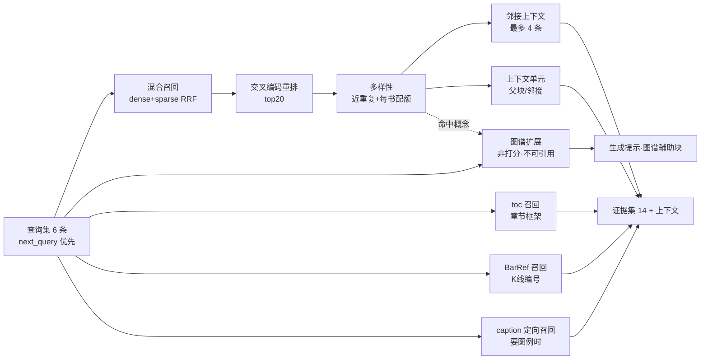

# 4. 检索优化

> 检索是 RAG 的胜负手。本章按"召回 → 融合 → 重排 → 后处理 → 多路补充"的顺序讲，并给出每个取舍的实测依据。

## 1. 全景

## 2. 混合检索与 RRF

每路召回 40 条，RRF 融合。**为什么用 RRF 而不是加权分数融合**：

- dense 分数是余弦相似度（0~1），sparse 分数是点积（可大于 1），两者量纲不同；
- 加权融合需要归一化与调参，且参数随查询分布漂移；
- RRF 只用**排名**，对量纲不敏感，鲁棒。

> 代价：RRF 丢弃了"分差"信息。如果某条 dense 结果遥遥领先，RRF 无法体现。当前数据规模下这个损失小于调参带来的不稳定性。

## 3. 交叉编码重排

- 模型：`bge-reranker-v2-m3`（本地 GPU，首次加载 0.24s）；
- 输入：RRF 前 20 条；
- 输出：重排后的 20 条，再交给多样性控制取 14 条；
- 失败降级：任何异常都追加到 `failures`，保留 RRF 顺序继续。

**为什么不用 LLM 重排**：每问多一次云端调用（延迟 +1~3s、成本翻倍），而本地 cross-encoder 已能解决"词汇相近但背景不同"的主要误排。

**为什么不上 ColBERT**：需要 late-interaction 索引与独立存储，与"嵌入式 Qdrant + 命名向量"的简洁路线冲突，收益在当前 9 万单元规模下不明显。

## 4. 多样性控制

两个规则：

1. **近重复抑制**：文本归一化（去空白）后取前 80 字做哈希，同哈希只保留排名最高的一条；
2. **每书配额**：同一 `doc_id` 最多 5 条。

**为什么需要**：同一概念在 7 份资料、中英版本中反复出现；术语表式的段落更是几乎逐字重复。不做控制时，top-14 可能被同一本书的同一段解释占满。

**为什么不做 embedding 聚类**：聚类要离线跑全量相似度或引入聚类索引，成本高；80 字哈希 + 配额已经能消除"同一段重复"这一主要问题，且零额外依赖。

## 5. 上下文扩展：邻接而不是父块

命中后展开两类上下文：

| 类型 | 上限 | 标记 | 用途 |
|---|---|---|---|
| 邻接单元 | 4 | "邻接段落" | 解释性段落的前后文 |
| 父块（若存在） | 6 | "父块上下文" | 兼容未来持久父块的摄入 |

**为什么是邻接**：父块在数据上不存在（743 个 parent_id 全部悬空，见第 1 章）。邻接按阅读顺序生成，回填 81,809 条，覆盖全部正文单元。

## 6. 目录（toc）召回

实现：从数据库派生的**章节索引**（每个 `(doc_id, chapter_path)` 去重），用 jieba 词项与查询求重叠，按"重叠数 ×（1 + 0.15 × 路径深度）"打分。

**为什么不把目录写成向量单元**：目录条目极短，嵌入区分度低；而章节名与查询的词项重叠本身就很强。DB 派生零索引成本，且章节新增时无需重建。

**效果**：框架问题（"市场周期如何转换"）会召回"第 5 章：趋势如何诞生、运行与衰亡"等章节路径，给生成器提供全书框架定位。

## 7. 图谱扩展

图谱不是一条打分路由，也不参与 RRF 融合（ADR-0003）。文本召回结束后，系统以概念为种子沿边补取证据，作为独立分区进入提示词；排序仍只由文本通道决定。

### 7.1 种子与边

- **种子两支**：查询词经词典命中的概念与文本召回并发；文本命中证据里出现的概念在召回返回后补一次。同一概念在一个请求里只展开一次，缺口轮只为新出现的概念补跑。
- **概念分类 1 跳**：`PART_OF` / `EXCEPTION_TO` / `INVALIDATED_BY` / `TRANSITIONS_TO`。证据取解析该边时留下的源头标题，因此仍能回到原文定位。
- **机制链 2 跳**：概念 → 对齐后的主张 → `SUPPORTED_BY` 证据。
- **标题解析是确定性的**：先按「同文档归一化文本相同留首次、出现 ≥5 次视为页眉」去重，再以「：」切分情境与条目；「失败」映射 `INVALIDATED_BY`，「随后」映射 `TRANSITIONS_TO`，「但…恢复/继续」与「例外」映射 `EXCEPTION_TO`，识别不出明确上级概念的条目直接丢弃，不兜底成 `PART_OF`。

**为什么用词典桥接**：查询说"市场周期"，图节点标签是"趋势生命周期"；只有通过词典的别名集合（两者同属 `market_cycle`）才能对上。

### 7.2 预算与截断

| 预算 | 上限 |
|---|---|
| 种子概念 | 8 |
| 边 | 32 |
| 回取证据 | 8 |
| 图块（估算 tokens） | 1,200 |

机制链优先于分类树，候选按种子顺序与主张置信度排序；截断不会把相关性更低的边提到前面。每类预算是否触顶都记录在 `graph_stats`（`truncated_edges` / `truncated_evidence` / `truncated_tokens`），离线回归据此统计。

### 7.3 不可引用与非重复

- 每条扩展证据标记 `provenance="graph"`、`non_citable=True`；
- 若该证据已在文本结果中，只保留「已见 [n]」指针，不重复正文；
- 引用编号只按文本命中与上下文单元生成，图谱证据永不进入 `evidence_ids`（ADR-0002）；生成提示里单独标注「不可引用，仅作理解辅助」。

### 7.4 能力边界与回归数字

图谱扩展**不扩大事实来源**：每条主张都由原文证据 `SUPPORTED_BY` 支撑，扩展只是把同一批原文证据中文本通道没排到的那部分找出来。它真正擅长的是关系——一个形态属于哪个家族、在什么条件下失效、阶段之间如何转换——这些是文本通道表达不出的。代价是结构边规模小、命中与否高度依赖种子概念能否被词典识别，且结果不能作为出处。

20 条金标准的离线回归（`scripts/eval_gold.py --mode graph`，6 条冻结查询不变）给出：

- 基线（每查询 top-20 并集）命中 24/50 条期望证据，其中 10 道题至少有一条期望证据在并集外（「图独有」口径）。
- 图谱扩展在 5 道题上召回到 6 条基线并集外的期望证据（5/10 道「图独有」题被覆盖），这是图谱可归因的增量。
- 但新链路文本侧只保留重排后的 14 条，基线并集里 8 条期望证据因此掉出；图谱补回其中 2 条，净丢失 6 条，总命中仍为 24/50。
- 因此：**「图谱扩展能召回文本 top-20 并集外的证据」得到支持；「图谱扩展带来净召回增益」被证伪（净增 0）**。原因是文本侧宽度差，不是图谱把证据挤掉；口径与基线均未调整。
- 20 道题全部触到「回取证据 ≤8」的预算（`truncated_evidence`），边与 token 预算未触顶。

## 8. BarRef 召回

触发条件：查询里出现 `K线N`、`bar N`、`图N`。

- 解析查询的编号集合；
- 与 `bar_refs.bars` 求交，按交集大小 + 图号匹配打分；
- 命中后把对应图并入 figures（供查看器）。

**为什么只在有编号时触发**：纯形态查询（"什么是双底"）用混合检索更合适；BarRef 是精确指代工具，不是通用召回。

## 9. caption 定向召回（要图例时）

当路由判定 `wants_examples=True`：

- 用**过滤检索**（`block_type=caption`）召回图注/观察单元；
- 取其 `figure_ids` 构建"图例目录"；
- 目录以 `figure_id + 图号` 的形式提供给生成器，模型只能从目录里选。

**为什么需要目录**：模型无法凭空生成 UUID 形式的 figure_id。没有目录时，它会编造"图4.4"这类字符串，最终全部被过滤掉（实测发生过）。

## 10. 跨轮证据累积与查询优先级

### 10.1 两个真实缺陷

1. `queries[:6]` 在 `next_query` 与 SOP 补充查询**追加之后**切片。基础查询集通常已满 6 条 → 补检索的新查询被静默丢弃，第二轮检索等于重复第一轮；
2. 每轮检索都从空字典重建候选集 → 上一轮证据丢失。

修复：

- 查询优先级：`next_query > SOP 补充查询 > 计划查询集`，去重后取前 6；
- 状态里维护 `acc`（证据累积字典），每轮在累积集上重排与截断。

## 11. 失败隔离

每条召回路径独立 `try/except`，异常写入 `failures` 并继续：

- 重排失败 → 用 RRF 顺序；
- 图谱失败 → 主检索不受影响；
- caption 召回失败 → 图例目录为空，而不是整个请求失败。

## 12. 本章小结

- 检索质量来自"多路召回 + 排名融合 + 后处理"的组合，而不是单点技巧。
- 后处理（多样性、上下文、去重）对资料性质敏感，必须针对语料设计。
- 每条路径都要有降级策略；"一个组件挂了全链路挂"是工程上不可接受的。
