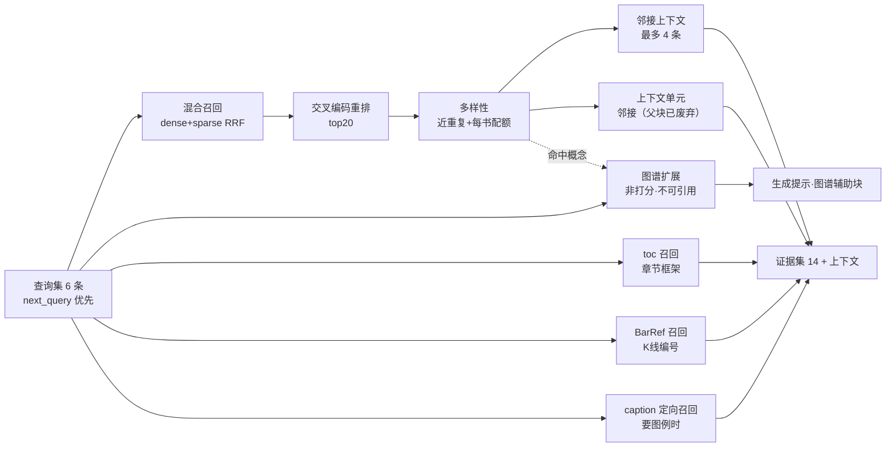

# 4. 检索优化

> 检索是 RAG 的胜负手。本章按"召回 → 融合 → 重排 → 后处理 → 多路补充"的顺序讲，并给出每个取舍的实测依据。

## 1. 全景

## 2. 混合检索与 RRF

每路召回 40 条，RRF 融合。**为什么用 RRF 而不是加权分数融合**：

- dense 分数是余弦相似度（0~1），sparse 分数是点积（可大于 1），两者量纲不同；
- 加权融合需要归一化与调参，且参数随查询分布漂移；
- RRF 只用**排名**，对量纲不敏感，鲁棒。

> 代价：RRF 丢弃了"分差"信息。如果某条 dense 结果遥遥领先，RRF 无法体现。当前数据规模下这个损失小于调参带来的不稳定性。

## 3. 交叉编码重排

- 模型：`bge-reranker-v2-m3`（本地 GPU；首次加载耗时未做基准测量，不作为指标引用）；
- 输入：累积候选里 RRF 前 80 条（`paknow/retrieval/pipeline.py:46`）；
- 打分口径：**用真正把这条证据召回来的那条查询打分**，跨查询取最高分（`paknow/retrieval/search.py:82`）。被 Step-Back 或子查询召回的单元不因为原问句措辞不合而被压低；跨轮次继承、没有归属的单元回退到改写后的原问句；
- 输出：重排后的 80 条，再交给多样性控制取 14 条；
- 失败降级：任何异常都追加到 `failures`，保留 RRF 顺序继续。

> 2026-10-25 之前是「用改写原问句给前 20 条打分」，实测把候选池里已有的期望证据丢掉 32 个；改成「按召回它的查询打分 + 池 80」后，同一批金题的文本臂 41/123 → 50/123（`.scratch/selection-funnel/`）。

**为什么不用 LLM 重排**：每问多一次云端调用（延迟 +1~3s、成本翻倍），而本地 cross-encoder 已能解决"词汇相近但背景不同"的主要误排。

**为什么不上 ColBERT**：需要 late-interaction 索引与独立存储，与"嵌入式 Qdrant + 命名向量"的简洁路线冲突，收益在当前 9 万单元规模下不明显。

## 4. 多样性控制

两个规则：

1. **近重复抑制**：文本归一化（去空白）后取前 200 字做哈希，同哈希只保留排名最高的一条；
2. **每书配额**：同一 `doc_id` 最多 8 条。

**为什么需要**：同一概念在 7 份资料、中英版本中反复出现；术语表式的段落更是几乎逐字重复。不做控制时，top-14 可能被同一本书的同一段解释占满。

**为什么是 200 字 / 8 条**：原来是 80 字 / 5 条。实测（`.scratch/selection-funnel/`）发现两个具体伤害：不同章节的同名标题共享前 80 字（"交易区间开盘：多头突破失败"在多章重复），同哈希只留排名最高的一条，而金标准要的常是另一条；另外百科一本书提供 123 个期望点里的 50 个，5 条配额直接把重排第 3 名的答案挤掉。放宽后这两类丢失消失，且没有让任何一层变差（百科 20/34、例外 9→15）。

**为什么不做 embedding 聚类**：聚类要离线跑全量相似度或引入聚类索引，成本高；200 字哈希 + 配额已经能消除"同一段重复"这一主要问题，且零额外依赖。

## 5. 上下文扩展：父块 + 邻接

命中后展开两类上下文：

| 类型 | 上限 | 编号 | 用途 |
|---|---|---|---|
| 邻接单元 | 4 | 有（可引用，标"邻接段落"） | 解释性段落的前后文 |
| 父块 | 6 | **无（不可引用）** | 子块被切开的整段原文（`paknow/retrieval/search.py:198-263`）；父块不入索引，只在命中子块后回查；超 2,400 字符按上下文截断；以"整段上下文"块单独渲染（`paknow/workflows/generate.py:262`） |

**为什么父块不占引用编号**：父块的文本包含命中子块自己的文字，两边都编号等于把同一段渲染两次——实测 114 条答案记录里 39 条同时引用了某父块和它自己的子块，而引父块的记录引用支撑分（1.06）低于不引的（1.18）。父块仍要送给模型（"这段话原来属于哪一整段"是解释性段落的必要前后文），但它不提供子块之外的新证据，因此只作上下文、不作引用来源。

**为什么是邻接**：父块回查曾经在数据上无效——1,670 个单元带 `parent_id`，其中 0 个能解析到父单元（本地库快照 2026-10-24），所以先做了按阅读顺序生成的邻接（91,235/91,235 个证据单元携带 `adjacent_ids`，非空 82,552）。2026-10-25 父块回填后两条并存：父块回答"这段话原来属于哪一整段"，邻接回答"这段话前后读什么"。

## 6. 目录（toc）召回

实现：从数据库派生的**章节索引**（每个 `(doc_id, chapter_path)` 去重），用 jieba 词项与查询求重叠，按"重叠数 ×（1 + 0.15 × 路径深度）"打分。

**为什么不把目录写成向量单元**：目录条目极短，嵌入区分度低；而章节名与查询的词项重叠本身就很强。DB 派生零索引成本，且章节新增时无需重建。

**效果**：框架问题（"市场周期如何转换"）会召回"第 5 章：趋势如何诞生、运行与衰亡"等章节路径，给生成器提供全书框架定位。

## 7. 图谱扩展

图谱不是一条打分路由，也不参与 RRF 融合（ADR-0003）。文本召回结束后，系统以概念为种子沿边补取证据，作为独立分区进入提示词；排序仍只由文本通道决定。

### 7.1 种子与边

- **种子两支**：查询词经词典命中的概念与文本召回并发；文本命中证据里出现的概念在召回返回后补一次。同一概念在一个请求里只展开一次，缺口轮只为新出现的概念补跑。
- **概念分类 1 跳**：`PART_OF` / `EXCEPTION_TO` / `INVALIDATED_BY` / `TRANSITIONS_TO`。证据取解析该边时留下的源头标题，因此仍能回到原文定位。
- **机制链 2 跳**：概念 → 对齐后的主张 → `SUPPORTED_BY` 证据。
- **标题解析是确定性的**：先按「同文档归一化文本相同留首次、出现 ≥5 次视为页眉」去重，再以「：」切分情境与条目；「失败」映射 `INVALIDATED_BY`，「随后」映射 `TRANSITIONS_TO`，「但…恢复/继续」与「例外」映射 `EXCEPTION_TO`，识别不出明确上级概念的条目直接丢弃，不兜底成 `PART_OF`。

**为什么用词典桥接**：查询说"市场周期"，图节点标签是"趋势生命周期"；只有通过词典的别名集合（两者同属 `market_cycle`）才能对上。

### 7.2 预算与截断

| 预算 | 上限 | 常量 |
|---|---|---|
| 种子概念 | 8 | `MAX_SEED_CONCEPTS` |
| 边 | 32 | `MAX_EDGES` |
| 回取证据 | **14** | `MAX_EVIDENCE` |
| 图块（估算 tokens） | 1,200 | `MAX_CONTEXT_TOKENS` |

四个上限硬编码在 `paknow/graph/expansion.py:34-37`。机制链优先于分类树；候选顺序是"种子顺序 → `extraction_confidence` 降序 → `claim_id`"（`paknow/graph/expansion.py:236-243`），截断不会把相关性更低的边提到前面。每类预算是否触顶都记录在 `graph_stats`（`truncated_edges` / `truncated_evidence` / `truncated_tokens`），离线回归据此统计。

### 7.3 不可引用与非重复

- 每条扩展证据标记 `provenance="graph"`、`non_citable=True`；
- 若该证据已在文本结果中，只保留「已见 [n]」指针，不重复正文；
- 引用编号只按文本命中与上下文单元生成，图谱证据永不进入 `evidence_ids`（ADR-0002）；生成提示里单独标注「不可引用，仅作理解辅助」。

### 7.4 能力边界与回归数字

图谱扩展**不扩大事实来源**：每条主张都由原文证据 `SUPPORTED_BY` 支撑，扩展只是把同一批原文证据中文本通道没排到的那部分找出来。它真正擅长的是关系——一个形态属于哪个家族、在什么条件下失效、阶段之间如何转换——这些是文本通道表达不出的。代价是结构边规模小、命中与否高度依赖种子概念能否被词典识别，且结果不能作为出处。

离线金标准回归（`scripts/eval_gold.py`，`graph_expansion_v2.json`：60 题 / 123 个期望证据点，每题 6 条冻结查询，产物在 `.scratch/`，本地库快照 2026-10-24）给出下面这组数。所有口径共用同一份数据集与同一个数据快照：

| 口径 | 命中期望点 | 完整命中题数 | 说明 |
|---|---|---|---|
| union probe（6 条冻结查询各 top-20 取并集） | 73/123 | 39/60 | 上界参照，没有多样性截断，不是线上链路 |
| text w14（生产宽度，关图谱） | 41/123 | 20/60 | 图谱臂相减的基线 |
| text w20（只把宽度放到 20） | 42/123 | 20/60 | 同一条链路，只改 `--text-width` |
| graph w14（生产链路，开图谱） | 55/123 | — | 其中图通道贡献 18 点 |
| graph w20 | 55/123 | — | 净增益比 w14 少 1 点 |

**怎么读这张表（口径必须写清）**：净增益的定义是 `graph_arm_found - regression_text_found`（`scripts/eval_gold.py:23-24`），即图谱臂总命中减去同宽度文本臂命中，**不是**图通道贡献本身。所以 w14 是 55 − 41 = +14，w20 是 55 − 42 = +13。图谱臂的 55 点由 41 点文本命中 + 18 点图通道证据 − 4 点重叠构成（18 − 14 = 4 是那两个口径相减得到的重叠数），三条数字自洽。

**诚实的结论**：

- **宽度不是灵丹**：文本臂 14 → 20 只多买 1 个期望点（41 → 42），完整命中题数没有变化（20/60），而图谱臂总数一动不动（55/123），净增益反而从 +14 掉到 +13。加宽唯一确定的效果是**把归因从图通道挪回文本通道**——同样 55 点，w20 下更少需要图谱来补。
- **图通道确实拿到了文本臂拿不到的期望点**：60 题里 21 题有"图通道有、文本臂没有"的期望点，这是图谱可归因的边界的量化。
- **不要拿它和 73 的并集比**：union probe 是上界参照，不做多样性截断，任何生产链路都不该指望追平它。真正的对比只能是同链路的 w14/w20 两列。
- **截断必然发生**：60/60 题都触到 `MAX_EVIDENCE=14` 的上限（`truncated_evidence`），0 次运行失败。也就是说上面所有差异都不是"某次跑挂了"，而是证据预算恒定卡死时的分布差异。
- 因此口径正确的表述是：**「图谱扩展能召回文本臂之外的证据」得到支持（21/60 题）；「图谱扩展带来净召回增益」也成立，但幅度是 +14/+13 个期望点，且随文本宽度增加而缩小**。此前的旧结论（净增 0）来自 20 题 v1 数据集与另一套基线口径，别再引用。

## 8. BarRef 召回

触发条件：查询里出现 `K线N`、`bar N`、`图N`。

- 解析查询的编号集合；
- 与 `bar_refs.bars` 求交，按交集大小 + 图号匹配打分；
- 命中后把对应图并入 figures（供查看器）。

**为什么只在有编号时触发**：纯形态查询（"什么是双底"）用混合检索更合适；BarRef 是精确指代工具，不是通用召回。

## 9. caption 定向召回（要图例时）

当路由判定 `wants_examples=True`：

- 用**过滤检索**（`block_type=caption`）召回图注/观察单元；
- 取其 `figure_ids` 构建"图例目录"；
- 目录以 `figure_id + 图号` 的形式提供给生成器，模型只能从目录里选。

**为什么需要目录**：模型无法凭空生成 UUID 形式的 figure_id。没有目录时，它会编造"图4.4"这类字符串，最终全部被过滤掉（实测发生过）。

## 10. 跨轮证据累积与查询优先级

### 10.1 两个真实缺陷

1. `queries[:6]` 在 `next_query` 与 SOP 补充查询**追加之后**切片。基础查询集通常已满 6 条 → 补检索的新查询被静默丢弃，第二轮检索等于重复第一轮；
2. 每轮检索都从空字典重建候选集 → 上一轮证据丢失。

修复：

- 查询优先级：`next_query > SOP 补充查询 > 计划查询集`，去重后取前 6；
- 状态里维护 `acc`（证据累积字典），每轮在累积集上重排与截断。

但**优先级列表最末尾还有一类查询会被切掉**：消歧变体由 `retrieval_queries()` 在 `[:6]` 截断之前追加到最后一个位置（`paknow/workflows/router.py:93-109`）。基础查询集（原问题、`step_back`、`sub_queries`、`hyde`）通常已经占满 6 条，所以"消歧变体排在最后、作为可选语境偏置"这个设计承诺，实际执行中经常变成"根本不存在"。要让 `BTC`/`AI` 这类歧义术语真正拿到语境偏置，得把它们提到配额内，而不是追加在队尾（详见第 5 章 §5）。

## 11. 失败隔离

每条召回路径独立 `try/except`，异常写入 `failures` 并继续：

- 重排失败 → 用 RRF 顺序；
- 图谱失败 → 主检索不受影响；
- caption 召回失败 → 图例目录为空，而不是整个请求失败。

## 12. 本章小结

- 检索质量来自"多路召回 + 排名融合 + 后处理"的组合，而不是单点技巧。
- 后处理（多样性、上下文、去重）对资料性质敏感，必须针对语料设计。
- 每条路径都要有降级策略；"一个组件挂了全链路挂"是工程上不可接受的。
