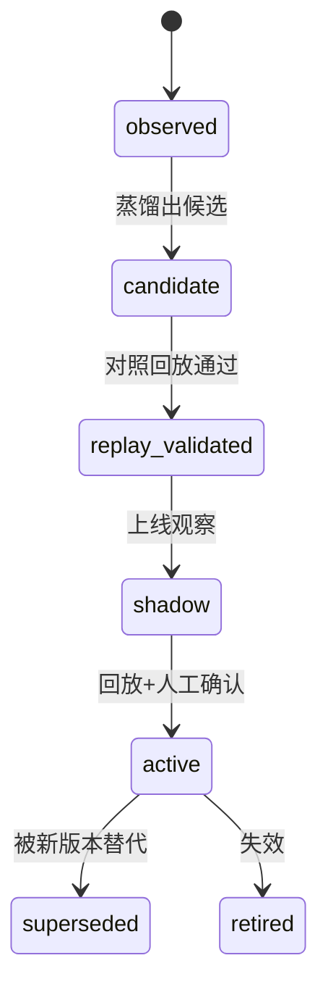
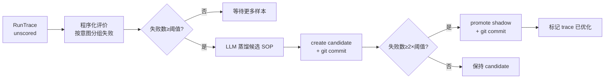

# 7. SOP 记忆与自动优化

> 大多数 RAG 只记录"问题与答案"。本系统额外记录**检索方法本身**，并让它可版本化、可回放、可回滚。这是"可验证 SOP 记忆"的核心。

## 1. 为什么需要程序性记忆

知识问答的失败往往不是"资料里没有"，而是"检索方法不适合这类问题"：

- 术语不对齐 → 零命中；
- 单一查询串 → 召回噪声；
- 证据只覆盖上位概念 → 答不到具体规则。

如果每次失败都靠人改代码，系统就停留在"手工作坊"。SOP 记忆要做的是：**把"某类问题应该怎么检索"沉淀成带状态的制品**。

## 2. 情节记忆：RunTrace

每次运行记录：

| 字段 | 用途 |
|---|---|
| `run_id` | 审计锚点 |
| `request` | 原问题 + 使用的 SOP |
| `intents` / `routes` | 路由结果 |
| `evidence_ids` | 实际引用的证据 |
| `output` | 答案、引用、不确定性 |
| `failures` | 各组件异常（降级记录） |
| `elapsed_ms` | 延迟 |
| `version_snapshot` | **corpus 指纹 + graph 规模 + 各模型名** |
| `score_status` | unscored / optimized |

**为什么记录版本快照**：同一个问题在不同语料/模型版本下的表现不能混在一起比较。快照让"回放"有明确的环境语义。

## 3. SOP 契约与生命周期



SOP 字段：

| 字段 | 含义 |
|---|---|
| `intent_scope` | 适用意图（精确匹配） |
| `preconditions` | 适用条件（自然语言） |
| `steps` | 有序步骤（operation + note） |
| `required_evidence` | 必须凑齐的证据类型 |
| `fallback` | 证据不足时的处理要求 |
| `stop` | 停止条件 |
| `failure_patterns` | 该 SOP 要覆盖的失败模式 |
| `compatible_versions` | 兼容的组件版本（不匹配则跳过） |
| `validation` | 回放记录（wins/losses/ties/dataset/approved） |

**为什么把 `required_evidence` 和 `fallback` 也放进 SOP**：检索方法不只是"查什么"，还包括"查不到时怎么办"。把降级策略写进 SOP，才能让不同方法有可比较的失败行为。

## 4. git 是记忆的版本管理

`memory/gitstore.py` 把每个 SOP 写成 `sop_registry/<sop_id>.yaml`，每次变更自动 commit：

```text
create: knowledge_qa_term_evidence_first v1 [candidate]
promote: knowledge_qa_term_evidence_first v1 [shadow]
```

**为什么用 git 而不是数据库版本表**：

| 需求 | git | 版本表 |
|---|---|---|
| 差异对比（diff） | ✅ 原生 | 需自己实现 |
| 追溯"谁/何时改了什么" | ✅ blame/log | 需自己实现 |
| 回滚到任意版本 | ✅ checkout | 需自己实现 |
| 人工审阅 | ✅ YAML + PR | 需自建界面 |

**工程细节**：`sop_registry/` 已并入主仓库（不再是嵌套仓库），gitstore 从该子目录执行 `git add -A .`，提交只作用于 SOP 文件；主仓库未初始化时静默跳过，不阻塞业务流程。

## 5. 自动闭环：评价 → 蒸馏 → 发布



### 5.1 评价信号（程序化，不是模型自评）

| 信号 | 判定 |
|---|---|
| `retrieval_error` | 运行记录里有检索异常 |
| `no_evidence` | 引用证据数为 0 |
| `low_evidence` | 引用证据数 < 2 |
| `no_answer` | 答案为空 |

按 `intent` 分组计数。**为什么不用 LLM 自评**：模型给自己打分不可信（系统的原则明确禁止"自评当裁判"）；程序化信号虽然粗，但方向明确——它指出"哪类问题在失败"，而不是"答案好不好"。

### 5.2 蒸馏

LLM 根据失败统计与问题样本产出 `CandidateSOP`（sop_id/意图范围/条件/步骤/证据要求/降级/停止条件/理由）。提示词要求"只依据给定失败记录，不凭空编造"。

### 5.3 发布与门槛

- 失败数 ≥ 阈值 → `candidate`；
- 失败数 ≥ 2×阈值 → 自动 `shadow`；
- **`active` 必须经过对照回放 + 人工确认**（当前未实现，因为评测集暂缓）。

**为什么自动只到 shadow**：shadow 的语义是"参与但非唯一依据"，可以在真实流量中收集对比数据；而 active 意味着"权威方法"，没有回放证据就晋升等于赌博。

### 5.4 触发方式

- 自动：每完成一次查询，若未评估 trace ≥ 20，后台线程执行一轮（非阻塞、带锁防重入）；
- 手动：`scripts/optimize_memory.py`。

## 6. SOP 在检索时如何生效

### 6.1 选择

`select_sop(intent)`：

1. 状态排序 `active > shadow > candidate`；
2. **精确意图匹配**（`intent in intent_scope`）；
3. `compatible_versions` 与当前组件指纹比对，不匹配则跳过（防止语料重建后沿用旧方法）。

> 早期实现用"`knowledge_qa` 在 scope 中即匹配"的通配规则，导致 QA 方法被套到图表分析/回测/学习路径上。已改为精确匹配。

### 6.2 解释执行

`apply_sop` 把步骤翻译成检索状态：

| operation | 动作 |
|---|---|
| `expand_terms` | 词典扩展 → 追加补充查询 |
| `step_back` | 若计划未给退步查询则补上 |
| `multi_query` / `hyde` | 标记启用 |
| `hybrid_search` | 默认流程已覆盖 |
| `expand_figures` | 标记展开图表 |
| `check_evidence` | 注入 `required_evidence` 到核验 |
| `rerank` | 标记启用 |

未知 operation 会记录到 `sop_skipped_ops`（不静默吞掉）。

**为什么不做"完整步骤自动执行器"**：默认检索流程已经实现了这些操作。SOP 的真实增量是**参数化**（补充查询、证据要求、降级策略、停止条件）与**可比较性**（trace 记录使用了哪条 SOP），而不是替代执行引擎。把 SOP 吹成"可编程 Agent"会引入不可控的执行路径。

## 7. 当前局限（必须如实说明）

1. **没有人工评测 → `active` 门槛关闭**：自动闭环只能到 `shadow`，记忆优化"只跑一半"。
2. **蒸馏质量未经回放验证**：候选 SOP 可能包含"看起来合理但无效"的方法。
3. **版本兼容只覆盖摘要指纹**：corpus 指纹变化时会跳过旧 SOP，但模型升级（同语料）不会触发失效。
4. **自动触发阈值（20）是经验值**：没有数据支撑最优值。

## 8. 本章小结

- 记忆的价值不在"记住答案"，而在"记住方法并验证方法"。
- git 让记忆可 diff、可 blame、可回滚，天然适合 SOP 制品。
- 自动闭环的每一步都必须有门槛与降级；没有回放证据时，系统只能"提议"，不能"裁决"。
