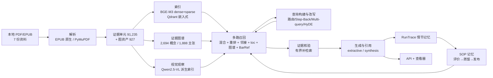

# PAknow 技术文档

> 一个面向**本地价格行为资料**（Al Brooks 系列 + 中文精翻 + 笔记）的多模态 RAG 系统：
> 可追溯出处的知识问答、上传图表分析、带条件的主张图谱，以及**可验证、可版本化、可回滚的程序性记忆（SOP）**。

本文档借鉴 [All-in-RAG](https://datawhalechina.github.io/all-in-rag/) 第 8/9 章的写法：**按 RAG 系统的设计流程逐步展开**，每一节都回答三个问题——这个环节要解决什么、为什么选这个方案、为什么不选另一个。这里不贴大段实现代码（代码在仓库里），重点讲**设计决策的来由和实测依据**。

## 这个系统解决什么问题

普通 RAG 在这批资料上会失效，原因不是"模型不够强"，而是资料本身的性质：

| 资料性质 | 对系统的要求 |
|---|---|
| 图表密集（927 张图，图注/K线编号/箭头） | 图文必须建立可检索的链接，而不是只索引文字 |
| 中英双语且**不是逐段对应**（中文精翻 vs 三卷英文） | 跨语言检索 + 术语对齐，不能假设翻译一一映射 |
| 条件化知识（"强趋势中 X，区间中 Y"） | 主张要保留条件（context/modality），检索要能按语境区分 |
| 大量缩写与专名（H2/L2/BTC/MTR/DBBF…） | 词法层必须保护领域词，否则稀疏检索被切碎 |
| 教学习题/案例、地图式叙述 | 问题往往需要**归纳机制**而非复述某一段 → 需要 synthesis 模式 |

## 三条设计主线

1. **可追溯**：任何结论都要能回到"哪本书、哪一章、哪个图、哪一页、哪段原文"。
2. **可验证**：图谱主张、视觉观察、SOP 都是"带状态"的产物；派生材料不能冒充权威原文。
3. **可回滚**：记忆（SOP）用 git 管理，每次变更都有版本与提交记录。

## 系统总览

## 阅读路径

- **想快速判断这个项目值不值得看**：直接读 [AI 评价](chapter11-ai-review.md)。
- **想理解每个技术选择**：从 [0. 系统架构与设计原则](chapter0-architecture.md) 顺序读到第 8 章。
- **想跑起来**：看 [运行示例](chapter10-examples.md)。
- **想知道还差什么**：看 [已完成与待补充](chapter9-status.md)。

## 与 plan.md 的关系

`plan.md` 是实施前的设计文档（含市场调研与验收细节）；本文档是**实施后的技术说明**，记录实际发生了什么、为什么这么做、哪些坑踩过并修好了。两者冲突时以本文档与代码为准。
